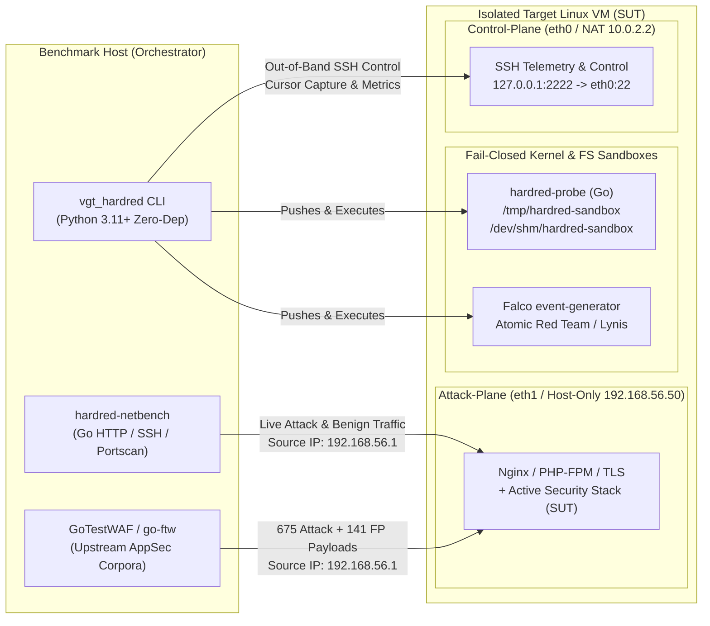

<div align="center">


# VGT HardRed (`RedHard`)
### Full-Stack Linux Security Benchmark, 4-Axis Evaluation Engine & Multi-Domain Telemetry Harness

[](LICENSE)
[](THIRD_PARTY_NOTICES.md)
[](CHANGELOG.md)
[](#-experimental-benchmark-disclaimer)
[-lightgrey?style=for-the-badge&logo=linux)](#-dual-plane-isolation-architecture)
[-3776AB?style=for-the-badge&logo=python)](#-quick-start--installation)
[](#-the-6-evaluation-domains--49-core-test-cases)
[](#-standardized-forensic--audit-exports)
[](#-the-4-axis-mathematical-scoring-model--fp-gates)
[](https://visiongaiatechnology.de)

**WAF & APPSEC · NETWORK IDS & XDP · KERNEL & ENDPOINT XDR · RANSOMWARE PRE-KILL CONTAINMENT · MALWARE & ARCHIVES · COMPLIANCE & OVERHEAD**

<br />

🌐 **Languages / Sprachen / Языки / 语言:**  
**English** · [Deutsch](README.de.md) · [Русский](README.ru.md) · [中文 (简体)](README.zh.md)

</div>

---

## ⚠️ Experimental Benchmark Disclaimer

> [!IMPORTANT]
> **Experimental Meta-Benchmark & Combined Verification Suite:**  
> **VGT HardRed (`RedHard`)** is an experimental, open-source security benchmark orchestration suite developed by **Vision Gaia Technology (VGT)**. It combines established, audited open-source testing frameworks (**Wallarm GoTestWAF**, **OWASP CRS go-ftw**, **CNCF Falco `event-generator`**, **Red Canary Atomic Red Team**, **CISOfy Lynis**, **ClamAV testfiles**, **Sysbench**, and **FIO**) with deterministic first-party Go kernel, ransomware, and network probes (`hardred-probe`, `hardred-netbench`) into a unified, snapshot-isolated evaluation pipeline.  
>
> **Authorized Lab Use Only:** Although all endpoint probes enforce strict fail-closed path jailing (`/tmp/hardred-sandbox` and `/dev/shm/hardred-sandbox`), this suite executes live application exploits, brute-force bursts, kernel syscall stimuli, and in-place AES-256 file encryption inside the target sandbox. Execute it **exclusively** against isolated virtual machines and laboratory networks that you own or are explicitly authorized to test.

---

## 1. Executive Overview — Why VGT HardRed Exists

Evaluating Linux security software in the real world is historically fragmented:
- **Web Application Firewalls (WAFs)** are tested in isolation with HTTP payload runners (`GoTestWAF`, `go-ftw`), ignoring host resource overhead or whether a single false positive triggers an IP-wide firewall lockout.
- **Endpoint Detection & Response (EDR/XDR) and Kernel LSMs** are tested with individual MITRE ATT&CK scripts (`Atomic Red Team`, `Falco event-generator`) that check whether a log line appeared, without measuring **Prevention vs. Detection**, **Time-to-First-Alert (TTFA)**, or **Pre-Kill Ransomware Damage** (how many files were encrypted before the process tree was frozen or terminated).
- **Network IDS / IPS & Bouncers** are rarely evaluated alongside endpoint and L7 defenses under identical kernel conditions, nor checked for cross-domain false-positive cascades.
- **Compliance & Performance** (`Lynis`, `sysbench`, `fio`, HTTP `p95`/`p99` latency, daemon RSS/CPU) are measured in separate benchmarks disconnected from active attack mitigation.

**VGT HardRed (`RedHard`)** unifies all six layers into a **single, vendor-neutral, snapshot-restored benchmark harness**. Every security system under test (`SUT`) faces the exact same OS image, kernel, web stack, attack vectors, benign false-positive controls, and hardware workload.

---

## 📊 VGT HardRed Benchmark — V6.2.0 Evaluation

Evaluated with the open-source **[VGT HardRed (`RedHard`)](https://github.com/visiongaiatechnology/redhard)** multi-domain Linux security benchmark on a clean snapshot-isolated **Ubuntu 24.04 (Linux HWE 7.0, NGINX + PHP 8.3-FPM)** target VM (`eth0` out-of-band control plane, `eth1` unallowlisted host-only attack plane; 4-axis model: Efficacy 45% · FP Resilience 20% · Latency & Containment 20% · Overhead 15%):

| Rank | Security Contender | Overall (0–100) | Axis 1: Efficacy | Axis 2: FP Resilience | Axis 3: Latency & Containment | Axis 4: Overhead | Gate |
|---:|---|---:|---:|---:|---:|---:|---|
| 1 | **[GeDefense Linux 6.2.0](https://github.com/visiongaiatechnology/gedefense) (`Max-Hardness`)** | **86.16** | **80.49** | **100.00** | **78.07** | **95.53** | **`PASS`** |
| 2 | **Wazuh (`Max Rules + FIM + Auditd + Active Response`)** | **46.29** | 31.74 | 69.23 | 22.14 | 91.53 | `CONDITIONAL` |
| Ref | **Baseline (`Clean Ubuntu HWE 7.0 WebStack`)** | **45.82** | 16.94 | 100.00 | 15.97 | 100.00 | `CONDITIONAL` |
| 3 | **CrowdSec (`Max Collections + Bouncers + AppSec WAF`)** | **35.83** | 42.89 | 0.00 | 28.38 | 72.37 | `FAIL` |

### GeDefense 6.2.0 Domain & Performance Breakdown

| Domain | Detection TPR | Prevention TPR | Det / Prot FPR | Context (0–3) | Median TTFA | Domain Score | Key Runtime Metric |
|---|---:|---:|---:|---:|---:|---:|---|
| `hardred-waf` | 100.0% | 100.0% | 0.0% / 0.0% | 3.00 | 250.0 ms | **100.0** | 0/8 benign FPs; HTTP `403` inline edge |
| `hardred-netids` | 100.0% | 100.0% | 0.0% / 0.0% | 2.50 | 175.9 ms | **98.3** | XDP/Kinetic drops HTTP flood, SSH spray & portscan |
| `hardred-compliance` | 100.0% | 86.0% | 0.0% / 0.0% | 3.00 | — | **86.0** | Lynis Hardening Index `71` (Baseline `63`); 8 active LSMs incl. `bpf` |
| `hardred-malware` | 100.0% | 33.3% | 0.0% / 0.0% | 1.67 | 250.0 ms | **65.6** | HTTP EICAR `403` + host `FAN_CLOSE_WRITE` & execution block |
| `hardred-endpoint` | 53.3% | 53.3% | 0.0% / 0.0% | 2.11 | 250.0 ms | **59.0** | **Damage Ratio `18.1%`** (Baseline `100.0%`): ransomware freeze & `memfd`/`/tmp` exec denied |

- **Measured System Overhead (`03d-gedefense-6.2.0-max-bench` vs. Clean Baseline):** `730.7` HTTP RPS (`8.74 ms` p50 · **`17.99 ms` p95** vs. `21.23 ms` baseline) · `90,420.3` Sysbench EPS · `245.2` FIO IOPS · **`83.3 MiB`** Security RSS · **`4.3%`** Security CPU.
> [!NOTE]
> **Environment Variance & Engineering Transparency:** Benchmark figures naturally vary by Linux kernel release and active LSM boot flags (`lsm=...,bpf`), CPU/I-O hardware, network topology, custom workload allowlists (for example, external payment/API egress destinations needed by production PHP/Node apps), and test harness versions. Earlier 6.1.2/6.2.0 test runs also exposed real bugs and open gaps — including non-root writer filtering in the on-write scanner, 1-second ransomware ring drain latency (reduced to 100 ms), missing login/account-management binaries in the Credential Guard allowlist, Rust `HARDENING_SET` vocabulary parity for `astraeaos-cis-l1`, and StyX cold-start cgroup drift — all of which were fixed cleanly in GeDefense 6.2.0 to strengthen real-world protection independent of any benchmark.

---


## 2. Dual-Plane Isolation Architecture

A common flaw in automated security benchmarks is **self-lockout**: as soon as an IPS, XDP filter, or firewall bouncer bans the attacker IP during a port scan or WAF test, the benchmark runner loses its SSH connection and cannot read telemetry or execute subsequent tests.

VGT HardRed solves this through strict **Dual-Plane Network Isolation** paired with **Hypervisor Snapshot Restoration**:



1. **Control-Plane (`127.0.0.1:2222 -> eth0:22`, Source IP `10.0.2.2`):** Used exclusively for snapshot synchronization, deploying `hardred-probe`, capturing telemetry cursors before and after each test case, and collecting `/proc` RSS/CPU metrics.
2. **Attack-Plane (`192.168.56.1 -> eth1:192.168.56.50`):** Carries all hostile and benign network/HTTP probes. The attacker IP `192.168.56.1` is **never** allowlisted. Between individual WAF/NetIDS cases, the contender adapter explicitly clears temporary attacker IP bans via the Control-Plane so each test case starts from a known clean state.
3. **Cold Snapshot Reset Per Contender:** Before benchmarking any contender (`baseline`, `gedefense`, `wazuh`, `crowdsec`, or custom), `VMController.restore_snapshot()` powers down the VM, restores the contender's dedicated snapshot, boots the guest, and waits for SSH and service readiness.

---

## 3. The 6 Evaluation Domains & 49 Core Test Cases

VGT HardRed executes **49 deterministic core test cases** (**36 attack vectors** + **13 benign false-positive controls**) across five security domains, plus an automated **GoTestWAF corpus run (816 payloads)**, a **Lynis + Kernel LSM compliance audit**, and a **4-dimensional performance benchmark**.

### 3.1 Domain 1 — `hardred-waf` (Weight: `25 %` · 14 Attack + 8 Benign Cases + GoTestWAF)

| Case ID | Polarity | MITRE | Tool / Source | Verification Target |
| :--- | :---: | :---: | :--- | :--- |
| `WAF-BENIGN-01..08` | `benign` | `NONE` | `hardred-http-keepalive` | 8 legitimate HTTP/JSON/UTF-8 requests (including English prose with SQL keywords `"Please select a union contract..."` and math query `calc=(10+20)*3/2`). **Any block triggers a WAF Protection False Positive.** |
| `WAF-SQLI-01` | `attack` | `T1190` | `hardred-http` | Classic `UNION ALL SELECT NULL,user(),database()--` injection |
| `WAF-SQLI-02` | `attack` | `T1190` | `hardred-http` | Inline comment-obfuscated boolean tautology (`/?id=1/**/oR/**/1=1--`) |
| `WAF-SQLI-03` | `attack` | `T1190` | `hardred-http` | JSON body SQL authentication bypass (`{"user":"admin' OR '1'='1"}`) |
| `WAF-XSS-01` | `attack` | `T1059.007` | `hardred-http` | Reflected `<script>alert(document.cookie)</script>` |
| `WAF-XSS-02` | `attack` | `T1059.007` | `hardred-http` | Event-handler SVG XSS (`<svg/onload=fetch('//evil.invalid')>`) |
| `WAF-LFI-01` | `attack` | `T1083` | `hardred-http` | Dot-dot-slash traversal (`../../../../etc/passwd`) |
| `WAF-LFI-02` | `attack` | `T1083` | `hardred-http` | Double URL-encoded traversal (`..%252f..%252f..%252fetc%252fshadow`) |
| `WAF-RCE-01` | `attack` | `T1059.004` | `hardred-http` | OS command chaining via query string (`?cmd=;cat%20/etc/passwd%23`) |
| `WAF-RCE-02` | `attack` | `T1505.003` | `hardred-http` | Raw PHP webshell upload (`<?php system($_GET['cmd']); eval($_POST['x']); ?>`) |
| `WAF-SSTI-01` | `attack` | `T1190` | `hardred-http` | Polyglot Server-Side Template Injection (`{{7*7}}${7*7}<%=7*7%>`) |
| `WAF-XXE-01` | `attack` | `T1190` | `hardred-http` | XML External Entity `SYSTEM "file:///etc/passwd"` injection |
| `WAF-SSRF-01` | `attack` | `T1552.005` | `hardred-http` | Cloud metadata IMDS SSRF (`http://169.254.169.254/latest/meta-data/...`) |
| `WAF-SCAN-01` | `attack` | `T1595.002` | `hardred-http` | Sensitive file probe (`/.env`) with `User-Agent: sqlmap/1.8.4#stable` |
| `WAF-FAILOPEN-01` | `attack` | `T1190` | `hardred-http` | Oversized 780 KB request body padding with trailing PHP execution payload |

### 3.2 Domain 2 — `hardred-netids` (Weight: `20 %` · 4 Attack + 2 Benign Cases)

| Case ID | Polarity | MITRE | Tool / Source | Verification Target |
| :--- | :---: | :---: | :--- | :--- |
| `NET-BENIGN-01` | `benign` | `NONE` | `hardred-netbench` | Paced legitimate HTTP traffic (6 requests @ 250 ms intervals) |
| `NET-BENIGN-02` | `benign` | `NONE` | `urllib-tls` | 4 standard TLS 1.3 HTTPS handshakes and GET requests |
| `NET-BRUTE-HTTP-01` | `attack` | `T1110.001` | `hardred-netprobe` | Rapid 25-attempt HTTP POST credential spray against `/wp-login.php` |
| `NET-BRUTE-SSH-01` | `attack` | `T1110.001` | `hardred-netbench` | 18-attempt SSH failed authentication burst (measures exact attempt index of IP drop) |
| `NET-VELOCITY-01` | `attack` | `T1499.002` | `hardred-netbench` | High-concurrency HTTP flood (240 requests across 28 concurrent workers) |
| `NET-PORTSCAN-01` | `attack` | `T1046` | `hardred-netbench` | 16-port TCP connect sweep across closed and open ports (`21..9200`) + post-scan ban check |

### 3.3 Domain 3 — `hardred-endpoint` (Weight: `35 %` · 15 Attack + 2 Benign Cases)

| Case ID | Polarity | MITRE | Tool / Source | Verification Target |
| :--- | :---: | :---: | :--- | :--- |
| `EP-BENIGN-01` | `benign` | `NONE` | `system-admin` | Benign admin maintenance (`dpkg-query`, `/etc/os-release` read, `tar.gz` backup, `sha256`). **0 % false-block tolerance.** |
| `EP-BENIGN-02` | `benign` | `NONE` | `bash+python3` | Standard administrative process pipeline verifying `/etc/nginx` directory |
| `EP-FILELESS-MEMFD-01` | `attack` | `T1620` | `hardred-probe` | Anonymous fileless execution via `memfd_create` + `execve("/proc/self/fd/<fd>")` |
| `EP-SHM-EXEC-01` | `attack` | `T1059.004` | `hardred-probe` | Dropper script staged and executed from `tmpfs` (`/dev/shm/hardred-sandbox`) |
| `EP-TMP-ELF-01` | `attack` | `T1204.002` | `hardred-probe` | Unverified binary copied into `/tmp/hardred-sandbox/tmpexec` and executed |
| `EP-LPE-KERNEL-01` | `attack` | `T1068` | `hardred-probe` | Exotic kernel socket creation (`IPPROTO_SCTP`, `IPPROTO_DCCP`, `AF_PACKET`), `ptrace`, `/etc/shadow` read |
| `EP-RANSOM-AES-01` | `attack` | `T1486` | `hardred-probe` | **In-place AES-256-GCM encryption of 120 realistic files** (measures Shannon entropy jump `~4.8 -> ~8.0`, TTFA, and exact `damaged / 120` pre-kill ratio) |
| `EP-RANSOM-STORM-01` | `attack` | `T1485` | `hardred-probe` | **600-file rapid rename & wipe storm** in 50-file batches (`damaged / 600` pre-kill ratio) |
| `EP-LINEAGE-CHILD-01` | `attack` | `T1059` | `hardred-probe` | Parent process spawns child worker conducting 60-file AES-256 burst (verifies process-tree / PGID kill resilience) |
| `EP-C2-EGRESS-01` | `attack` | `T1071.001` | `styx-cgroup-curl` | Outbound C2 connection (`curl http://1.1.1.1/`) launched from inside the active `php8.3-fpm.service` cgroup |
| `EP-FALCO-01..03` | `attack` | `T1003` / `T1036` / `T1055` | `falco-event-generator` | Real kernel syscalls: `ReadSensitiveFileUntrusted`, `CreateSymlinkOverSensitiveFiles`, `PtraceAntiDebugAttempt` |
| `EP-ART-T1087..T1548` | `attack` | `T1087` / `T1059` / `T1053` / `T1548` | `atomic-red-team` | Curated Linux Atomic TTPs: account discovery, base64 shell pipe, crontab persistence staging, SUID enumeration |

### 3.4 Domain 4 — `hardred-malware` (Weight: `10 %` · 3 Attack + 1 Benign Cases)

| Case ID | Polarity | MITRE | Tool / Source | Verification Target |
| :--- | :---: | :---: | :--- | :--- |
| `MAL-BENIGN-01` | `benign` | `NONE` | `hardred-malware` | Clean JSON manifest and minified JS bundle written to sandbox |
| `MAL-EICAR-DISK-01` | `attack` | `T1027` | `eicar-standard` | On-disk EICAR payload drop + check for real-time alert and automatic file quarantine |
| `MAL-EICAR-HTTP-01` | `attack` | `T1105` | `eicar-http` | Inline HTTP `POST` binary EICAR upload through the web/WAF stack |
| `MAL-NESTED-ARCHIVE-01` | `attack` | `T1027.002` | `clamav-testfiles` | 8-layer nested ZIP recursion wrapper + `clam.bz2.zip` archive inspection |

### 3.5 Domains 5 & 6 — `hardred-compliance` (`10 %`) & `hardred-perf` (`Axis 4`)
- **`hardred-compliance`:** Runs `Lynis 3.1.8` (`./lynis audit system --quick --no-colors`) to extract the host `Hardening Index`, warning count, and suggestion count, combined with active Linux Security Modules from `/sys/kernel/security/lsm`.
- **`hardred-perf`:** Executes `hardred-netbench http-bench` (concurrency 16, 4,000 requests -> `RPS`, `p50`, `p95`, `p99`), `sysbench cpu run`, `fio` random-write with `fsync=1`, and samples the resident set size (`RSS MiB`) and CPU utilization (`%`) of all active security daemon processes.

---

## 4. The 4-Axis Mathematical Scoring Model & FP Gates

Implemented in [vgt_hardred/scoring.py](vgt_hardred/scoring.py), the scoring engine enforces strict separation between **passive detection** and **active prevention**:

1. **Per-Domain Score (`0–100`):**
   $$\text{DomainScore} = 100 \times \left( 0.30 \cdot \text{TPR}_{\text{det}} + 0.45 \cdot \text{TPR}_{\text{prev}} + 0.15 \cdot \text{BalancedAcc} + 0.10 \cdot \frac{\text{ContextMaturity}}{3.0} \right)$$
   where **Context Maturity** is scored deterministically per alert in [vgt_hardred/adapters/base.py](vgt_hardred/adapters/base.py):
   - `0` = Blind (no alert)
   - `1` = Generic counter or IP notice without rich attributes
   - `2` = Rich telemetry (≥ 2 attributes among `pid`, `exe`, `process`, `uri`, `src_ip`, `rule_id`, `target`, `cmdline`)
   - `3` = Causal correlation, process lineage (`ppid`/`lineage`), attack-story DAG, or cryptographic evidence hash

2. **Axis 1 — Weighted Security Efficacy (`45 %` of Overall):**
   $$\text{Axis}_1 = 0.35 \cdot S_{\text{endpoint}} + 0.25 \cdot S_{\text{waf}} + 0.20 \cdot S_{\text{netids}} + 0.10 \cdot S_{\text{malware}} + 0.10 \cdot S_{\text{compliance}}$$

3. **Axis 2 — False-Positive Resilience & AMTSO/WCP Gates (`20 %` of Overall):**
   $$\text{Axis}_2 = \max\left(0,\; 100 - \left(200 \cdot \text{FPR}_{\text{det,all}} + 600 \cdot \text{FPR}_{\text{prot,all}}\right)\right)$$
   - **`Gate: FAIL`** if Endpoint Protection FPR $> 0.0\%$ (any blocked admin control) **or** WAF Protection FPR $> 1.0\%$.
   - **`Gate: CONDITIONAL`** if Endpoint or WAF Detection FPR $> 5.0\%$, or for the unprotected baseline reference.
   - **`Gate: PASS`** when all protection and detection false-positive thresholds are satisfied.

4. **Axis 3 — Reaction Latency (TTFA) & Pre-Kill Damage Containment (`20 %` of Overall):**
   $$\text{Axis}_3 = 0.55 \cdot \text{Score}_{\text{TTFA}} + 0.45 \cdot \left(1 - \overline{\text{DamageRatio}}\right) \times 100$$
   - $\text{Score}_{\text{TTFA}}$ uses a logarithmic decay curve ($100$ at $\le 50\text{ ms}$, $100 - 24 \cdot \log_{10}(\text{TTFA}_{\text{ms}}/50)$ above $50\text{ ms}$) scaled by detection coverage.
   - $\overline{\text{DamageRatio}}$ averages `damaged_files / total_files` across `EP-RANSOM-AES-01` (`120`), `EP-RANSOM-STORM-01` (`600`), and `EP-LINEAGE-CHILD-01` (`60`). A security product that detects ransomware after all `120/120` files are encrypted receives `0` containment points on that test.

5. **Axis 4 — Operational Overhead & Stability vs. Baseline (`15 %` of Overall):**
   Deducts bounded penalties for HTTP `p95` latency inflation (up to `35` pts), `fio` IOPS degradation (up to `15` pts), daemon RSS memory footprint (`18` pts per GiB, up to `30` pts), and daemon CPU load (up to `20` pts).

---

## 5. How to Independently Benchmark Any Linux Security System

VGT HardRed is built around a clean, vendor-agnostic **`ContenderAdapter` protocol** ([vgt_hardred/adapters/base.py](vgt_hardred/adapters/base.py)). Out of the box, the repository includes four adapters:
- `baseline`: Clean Linux WebStack reference ([vgt_hardred/adapters/baseline.py](vgt_hardred/adapters/baseline.py))
- `gedefense`: GeDefense Linux Security Fabric ([vgt_hardred/adapters/gedefense.py](vgt_hardred/adapters/gedefense.py))
- `wazuh`: Wazuh Manager/Agent + Active Response + Auditd ([vgt_hardred/adapters/wazuh.py](vgt_hardred/adapters/wazuh.py))
- `crowdsec`: CrowdSec Security Engine + Firewall & Nginx AppSec Bouncers ([vgt_hardred/adapters/crowdsec.py](vgt_hardred/adapters/crowdsec.py))

### Adding a New Security System (e.g., Falco, Tetragon, ModSecurity/Coraza, OSSEC)

1. **Prepare a Clean VM Snapshot:**
   Install your security product on the target Linux VM, configure its ruleset to the desired production/maximum profile, ensure the Control-Plane source IP (`10.0.2.2`) can reach SSH, and take a VirtualBox snapshot (e.g., `06-falco-max`).
2. **Implement the 5-Method `ContenderAdapter` Interface in `vgt_hardred/adapters/<name>.py`:**
   ```python
   from vgt_hardred.adapters.base import AdapterCursor, TelemetryVerdict, compute_context_maturity
   from vgt_hardred.models import GroundTruthCase
   from vgt_hardred.vm_control import VMController

   class CustomSecurityAdapter:
       contender_id = "custom_sec"

       def __init__(self, vm: VMController) -> None:
           self.vm = vm

       def service_names(self) -> list[str]:
           return ["custom-sec-daemon"]

       def prepare(self) -> None:
           self.vm.ensure_sandboxes()

       def clear_attacker_blocks(self) -> None:
           # Clear temporary bans of self.vm.cfg.attacker_source_ip between test cases
           self.vm.ssh(f"sudo custom-cli unban {self.vm.cfg.attacker_source_ip} || true")

       def capture_cursor(self) -> AdapterCursor:
           # Record log byte offset or API event counter before the test case starts
           _, out, _ = self.vm.ssh("sudo stat -c %s /var/log/custom-sec/alerts.json || echo 0")
           return AdapterCursor(captured_utc="", state={"offset": int(out.strip() or 0)})

       def collect_since(self, cursor: AdapterCursor, case: GroundTruthCase, started_utc: str, settle_sec: float = 1.5) -> TelemetryVerdict:
           # Read new JSON alerts emitted since cursor.state["offset"], compute TTFA and context maturity
           ...
   ```
3. **Register the Contender in [configs/targets.json](configs/targets.json) and [vgt_hardred/cli.py](vgt_hardred/cli.py)** and run the suite.

---

## 6. Quick Start & Installation

### 6.1 Prerequisites
- **Host OS:** Windows 10/11 or Linux x86_64 with **Python 3.11+**, **Go 1.22+**, **Git**, **OpenSSH Client** (`ssh`, `scp`), and **Oracle VirtualBox** (`VBoxManage`) or KVM/SSH target.
- **Target VM:** Ubuntu 24.04 LTS (HWE Kernel `6.8+` or `7.0+`), Nginx + PHP-FPM on `eth1` (`192.168.56.50`), SSH on `eth0` (`127.0.0.1:2222`), `sysbench` and `fio` installed.

### 6.2 Bootstrap First-Party Go Probes & Pinned Upstream Suites
```bash
git clone https://github.com/visiongaiatechnology/redhard.git
cd redhard

# Compile static Go probes (probes/bin/*) and fetch/compile pinned third-party suites (third_party/*)
python scripts/bootstrap_third_party.py

# Or compile only the first-party Go probes without cloning third-party repositories:
python scripts/bootstrap_third_party.py --probes-only
```

### 6.3 Configure Target VM & Run Benchmarks
1. Copy `configs/targets.example.json` to `configs/targets.json` and set your SSH key path (`ssh_key`), VM name, and contender snapshot names.
2. Execute a full multi-contender benchmark or evaluate a single contender:
```bash
# Run against all configured contenders in configs/targets.json
python -m vgt_hardred run --config configs/targets.json --results-dir results

# Run against a single contender (e.g., after updating its configuration or ruleset)
python -m vgt_hardred run --config configs/targets.json --contenders gedefense --results-dir results

# Re-compute all 4-axis scorecards, OCSF/SARIF/ATT&CK exports, CSV, and Glass 2100 HTML dashboard from saved raw runs
python -m vgt_hardred rescore --config configs/targets.json --results-dir results
```

### 6.4 Run Unit & Security Boundary Tests
```bash
# Python unit tests (4-axis scoring math, AMTSO/WCP gates, OCSF/SARIF/ATT&CK schemas, sandbox path-jail verification)
python -m unittest discover -s tests -v

# Go probe unit tests (sandbox jail traversal rejection, entropy math, AES-256-GCM burst, netbench parsers)
cd probes && go test -count=1 -v ./...
```

---

## 7. Standardized Forensic & Audit Exports

Every benchmark run writes deterministic, machine-verifiable artifacts under `results/`:
- **`results/<contender>/scorecard.json` & `meta.json`:** Complete per-case ground truth, raw telemetry alerts, TTFA timestamps, pre-kill damage counts, and performance metrics.
- **`results/<contender>/<contender>.ocsf.jsonl`:** Open Cybersecurity Schema Framework (`v1.9.0`) Detection Finding (`class_uid: 2004`) stream.
- **`results/<contender>/<contender>.sarif.json`:** OASIS SARIF `v2.1.0` report for automated security dashboards.
- **`results/<contender>/<contender>.attack_layer.json`:** MITRE ATT&CK Navigator `v4.5` layer file for visual coverage inspection.
- **`results/FINAL_BENCHMARK_REPORT.md` & `results/VGT_HardRed_Comparison.csv`:** Full multi-contender ranking tables and per-case comparison matrix.
- **`results/VGT_HardRed_Dashboard.html`:** Standalone, zero-external-dependency interactive **VGT Glass 2100 HTML5 Dashboard**.

---

## 8. Repository Structure & Licensing

```text
redhard/
├── assets/
│   └── vgtcode.png                 # Vision Gaia Technology emblem
├── configs/
│   ├── benchmark_matrix.json       # 6-domain benchmark profile definition
│   ├── targets.example.json        # Sanitized hypervisor & contender configuration template
│   └── targets.json                # Default benchmark configuration
├── probes/                         # First-party static Go probes (AGPL-3.0-only)
│   ├── cmd/hardred-probe/          # Endpoint kernel, memfd, LPE & ransomware simulator
│   ├── cmd/hardred-netbench/       # HTTP load, velocity burst, TCP portscan & SSH spray tool
│   └── internal/{jail,metrics,netbench,probe}/
├── scripts/
│   └── bootstrap_third_party.py    # Deterministic builder for Go probes & pinned OSI suites
├── tests/
│   └── test_hardred.py             # Scoring, exporter schema & fail-closed jail unit tests
├── third_party/
│   └── THIRD_PARTY_NOTICES.md      # Upstream commits, SHA-256 digests & OSI license notices
├── vgt_hardred/                    # First-party Python 3.11+ orchestrator (AGPL-3.0-only)
│   ├── adapters/                   # Pluggable contender adapters (baseline, gedefense, wazuh, crowdsec)
│   ├── runners/                    # 6 domain execution engines (waf, netids, endpoint, malware, compliance, perf)
│   ├── cli.py                      # CLI entry point (run, rescore)
│   ├── exporters.py                # OCSF 1.9.0, SARIF 2.1.0 & MITRE ATT&CK Navigator exporters
│   ├── models.py                   # Strict dataclasses for GroundTruthCase, CaseResult & Scorecards
│   ├── report_glass.py             # Markdown report, CSV & VGT Glass 2100 HTML5 dashboard generator
│   ├── scoring.py                  # 4-Axis mathematical scoring & AMTSO/WCP gate engine
│   └── vm_control.py               # Hypervisor snapshot restore & out-of-band SSH/SCP controller
├── ARCHITECTURE.md                 # Architectural & mathematical specification
├── CHANGELOG.md                    # Release history
├── LICENSE                         # GNU Affero General Public License v3.0 (AGPL-3.0-only)
├── README.md                       # Primary documentation (English)
├── README.de.md                    # German documentation (Deutsch)
├── README.ru.md                    # Russian documentation (Русский)
├── README.zh.md                    # Simplified Chinese documentation (中文)
├── SECURITY.md                     # Responsible use & vulnerability reporting policy
├── THIRD_PARTY_NOTICES.md          # Complete third-party attribution & license ledger
├── VERSION                         # Release version (1.0.1)
└── pyproject.toml                  # Python package manifest
```

### License
- **First-Party Code:** Licensed under the **GNU Affero General Public License v3.0 only (`AGPL-3.0-only`)** — see [LICENSE](LICENSE).
- **Third-Party Benchmark Suites:** Governed by their respective upstream open-source licenses (`MIT`, `Apache-2.0`, `GPL-2.0`, `GPL-3.0`) as documented in [THIRD_PARTY_NOTICES.md](THIRD_PARTY_NOTICES.md).
