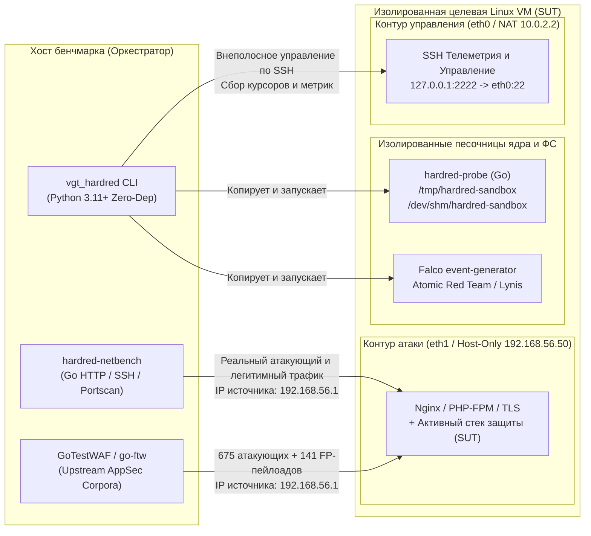

<div align="center">


# VGT HardRed (`RedHard`)
### Комплексный бенчмарк безопасности Linux, 4-осевой механизм оценки и мультидоменная платформа телеметрии

[](LICENSE)
[](THIRD_PARTY_NOTICES.md)
[](CHANGELOG.md)
[](#️-уведомление-об-экспериментальном-комбинированном-бенчмарке)
[-lightgrey?style=for-the-badge&logo=linux)](#-2-архитектура-двухконтурной-изоляции-dual-plane)
[-3776AB?style=for-the-badge&logo=python)](#-6-быстрый-старт-и-установка)
[](#-3-шесть-доменов-оценки-и-49-базовых-тест-кейсов)
[](#-7-стандартизированный-экспорт-для-форензики-и-аудита)
[](#-4-математическая-4-осевая-модель-оценки-и-fp-гейты)
[](https://visiongaiatechnology.de)

**WAF & APPSEC · NETWORK IDS & XDP · KERNEL & ENDPOINT XDR · СДЕРЖИВАНИЕ RANSOMWARE ДО УНИЧТОЖЕНИЯ ФАЙЛОВ · MALWARE И АРХИВЫ · КОМПЛАЕНС И НАГРУЗКА**

<br />

🌐 **Languages / Sprachen / Языки / 语言:**  
[English](README.md) · [Deutsch](README.de.md) · **Русский** · [中文 (简体)](README.zh.md)

</div>

---

## ⚠️ Уведомление об экспериментальном комбинированном бенчмарке

> [!IMPORTANT]
> **Экспериментальный мета-бенчмарк и комбинированный комплекс проверки:**  
> **VGT HardRed (`RedHard`)** — это экспериментальный пакет оркестрации бенчмарков безопасности с открытым исходным кодом, разработанный **Vision Gaia Technology (VGT)**. Он объединяет проверенные фреймворки тестирования с открытым исходным кодом (**Wallarm GoTestWAF**, **OWASP CRS go-ftw**, **CNCF Falco `event-generator`**, **Red Canary Atomic Red Team**, **CISOfy Lynis**, **ClamAV testfiles**, **Sysbench** и **FIO**) с детерминированными зондами ядра, программами-вымогателями и сетевыми генераторами на Go (`hardred-probe`, `hardred-netbench`) в единый конвейер оценки с изоляцией на уровне снапшотов.  
>
> **Только для авторизованных лабораторных сред:** Несмотря на то, что все конечные зонды защищены строгим механизмом изоляции путей (`fail-closed` path jailing в `/tmp/hardred-sandbox` и `/dev/shm/hardred-sandbox`), этот пакет выполняет реальные веб-эксплойты, серии атак грубой силы (brute-force), вызовы системных функций ядра и шифрование файлов AES-256 внутри песочницы. Запускайте его **исключительно** на изолированных виртуальных машинах и в лабораторных сетях, которые принадлежат вам или на тестирование которых у вас есть явное письменное разрешение.

---

## 1. Обзор — Зачем был создан VGT HardRed

Традиционная оценка программного обеспечения безопасности для Linux сильно фрагментирована:
- **Межсетевые экраны веб-приложений (WAF)** тестируются изолированно с помощью HTTP-генераторов (`GoTestWAF`, `go-ftw`) без учета потребления ресурсов хоста или того, приводит ли одно ложное срабатывание (False Positive) к полной блокировке IP-адреса клиента на уровне сетевого экрана.
- **Системы EDR/XDR и модули безопасности ядра (LSM)** обычно проверяются отдельными скриптами MITRE ATT&CK (`Atomic Red Team`, `Falco event-generator`), которые лишь фиксируют появление строки в логах, не разделяя **Предотвращение (Prevention) и Обнаружение (Detection)**, не измеряя **время до первого оповещения (TTFA)** и **ущерб до остановки шифровальщика (Pre-Kill Ransomware Damage)** — сколько файлов было зашифровано до заморозки или завершения дерева процессов.
- **Сетевые IDS/IPS и баунсеры** редко тестируются совместно с защитой конечных точек и уровня L7 в идентичных условиях ядра, а также не проверяются на каскадные ложные блокировки между доменами.
- **Комплаенс и системные накладные расходы** (`Lynis`, `sysbench`, `fio`, задержка HTTP `p95`/`p99`, потребление RAM RSS и CPU демонами безопасности) измеряются в отдельных тестах в отрыве от активного отражения атак.

**VGT HardRed (`RedHard`)** объединяет все шесть уровней в **единый, независимый от вендора тестовый стенд с восстановлением снапшотов**. Каждая тестируемая система безопасности (`SUT`) проходит проверку на идентичном образе ОС, ядре, веб-стеке, наборе векторов атак, контрольных тестах на ложные срабатывания и аппаратной нагрузке.

---

## 2. Архитектура двухконтурной изоляции (Dual-Plane)

Типичный недостаток автоматизированных бенчмарков безопасности — **самоблокировка (self-lockout)**: как только IPS, фильтр XDP или файрвол-баунсер блокирует IP-адрес атакующего во время сканирования портов или теста WAF, оркестратор теряет SSH-соединение и не может ни собрать телеметрию, ни запустить следующие тесты.

VGT HardRed решает эту проблему за счет строгого **разделения сети на два контура (Dual-Plane)** в сочетании с **восстановлением снапшотов гипервизора**:



1. **Контур управления (`Control-Plane`, `127.0.0.1:2222 -> eth0:22`, IP источника `10.0.2.2`):** Используется исключительно для синхронизации снапшотов, доставки `hardred-probe`, фиксации курсоров телеметрии до и после каждого тест-кейса и сбора метрик `/proc` (RSS/CPU).
2. **Контур атаки (`Attack-Plane`, `192.168.56.1 -> eth1:192.168.56.50`):** Передает все атакующие и легитимные сетевые/HTTP-запросы. IP-адрес атакующего `192.168.56.1` **никогда** не добавляется в белые списки. Между отдельными кейсами WAF/NetIDS адаптер снимает временные блокировки IP атакующего через контур управления, чтобы каждый тест начинался с чистого состояния.
3. **Холодный сброс снапшота для каждого участника:** Перед тестированием любого решения (`baseline`, `gedefense`, `wazuh`, `crowdsec` или пользовательской системы) `VMController.restore_snapshot()` выключает ВМ, восстанавливает выделенный снапшот, загружает гостевую ОС и дожидается готовности SSH и сервисов.

---

## 3. Шесть доменов оценки и 49 базовых тест-кейсов

VGT HardRed выполняет **49 детерминированных базовых тест-кейсов** (**36 векторов атак** + **13 легитимных контролей на ложные срабатывания**) в пяти доменах безопасности, дополненных автоматическим прогоном корпуса **GoTestWAF (816 пейлоадов)**, аудитом комплаенса **Lynis + Kernel LSM** и **4-мерным тестом производительности**.

### 3.1 Домен 1 — `hardred-waf` (Вес: `25 %` · 14 атак + 8 легитимных контролей + GoTestWAF)

| ID кейса | Полярность | MITRE | Инструмент / Источник | Цель проверки |
| :--- | :---: | :---: | :--- | :--- |
| `WAF-BENIGN-01..08` | `benign` | `NONE` | `hardred-http-keepalive` | 8 легитимных запросов HTTP/JSON/UTF-8 (включая английскую фразу со словами SQL `"Please select a union contract..."` и математический запрос `calc=(10+20)*3/2`). **Любая блокировка считается ложным срабатыванием защиты WAF (Protection FP).** |
| `WAF-SQLI-01` | `attack` | `T1190` | `hardred-http` | Классическая SQL-инъекция `UNION ALL SELECT NULL,user(),database()--` |
| `WAF-SQLI-02` | `attack` | `T1190` | `hardred-http` | Булева тавтология с обфускацией SQL-комментариями (`/?id=1/**/oR/**/1=1--`) |
| `WAF-SQLI-03` | `attack` | `T1190` | `hardred-http` | Обход аутентификации через SQLi в JSON (`{"user":"admin' OR '1'='1"}`) |
| `WAF-XSS-01` | `attack` | `T1059.007` | `hardred-http` | Отраженная XSS `<script>alert(document.cookie)</script>` |
| `WAF-XSS-02` | `attack` | `T1059.007` | `hardred-http` | SVG XSS через обработчик событий (`<svg/onload=fetch('//evil.invalid')>`) |
| `WAF-LFI-01` | `attack` | `T1083` | `hardred-http` | Обход каталога (`../../../../etc/passwd`) |
| `WAF-LFI-02` | `attack` | `T1083` | `hardred-http` | Двойное URL-кодирование обхода пути (`..%252f..%252f..%252fetc%252fshadow`) |
| `WAF-RCE-01` | `attack` | `T1059.004` | `hardred-http` | Инъекция команд ОС через параметр запроса (`?cmd=;cat%20/etc/passwd%23`) |
| `WAF-RCE-02` | `attack` | `T1505.003` | `hardred-http` | Загрузка PHP веб-шелла в теле POST (`<?php system($_GET['cmd']); eval($_POST['x']); ?>`) |
| `WAF-SSTI-01` | `attack` | `T1190` | `hardred-http` | Полиглот-инъекция шаблонов SSTI (`{{7*7}}${7*7}<%=7*7%>`) |
| `WAF-XXE-01` | `attack` | `T1190` | `hardred-http` | Внешняя сущность XML `SYSTEM "file:///etc/passwd"` |
| `WAF-SSRF-01` | `attack` | `T1552.005` | `hardred-http` | SSRF-обращение к облачным метаданным IMDS (`http://169.254.169.254/latest/meta-data/...`) |
| `WAF-SCAN-01` | `attack` | `T1595.002` | `hardred-http` | Запрос к скрытому файлу (`/.env`) с заголовком `User-Agent: sqlmap/1.8.4#stable` |
| `WAF-FAILOPEN-01` | `attack` | `T1190` | `hardred-http` | Проверка инспекции крупного тела запроса (780 КБ паддинга с PHP-шеллом в конце) |

### 3.2 Домен 2 — `hardred-netids` (Вес: `20 %` · 4 атаки + 2 легитимных контроля)

| ID кейса | Полярность | MITRE | Инструмент / Источник | Цель проверки |
| :--- | :---: | :---: | :--- | :--- |
| `NET-BENIGN-01` | `benign` | `NONE` | `hardred-netbench` | Размеренный легитимный HTTP-трафик (6 запросов с интервалом 250 мс) |
| `NET-BENIGN-02` | `benign` | `NONE` | `urllib-tls` | 4 стандартных рукопожатия TLS 1.3 и HTTPS GET-запроса |
| `NET-BRUTE-HTTP-01` | `attack` | `T1110.001` | `hardred-netprobe` | Быстрый подбор паролей методом HTTP POST (25 попыток к `/wp-login.php`) |
| `NET-BRUTE-SSH-01` | `attack` | `T1110.001` | `hardred-netbench` | Серия из 18 неудачных попыток входа по SSH (измерение индекса блокировки IP) |
| `NET-VELOCITY-01` | `attack` | `T1499.002` | `hardred-netbench` | Высокопараллельный HTTP-флуд (240 запросов в 28 потоков) |
| `NET-PORTSCAN-01` | `attack` | `T1046` | `hardred-netbench` | TCP-сканирование 16 закрытых и открытых портов (`21..9200`) + проверка бана после сканирования |

### 3.3 Домен 3 — `hardred-endpoint` (Вес: `35 %` · 15 атак + 2 легитимных контроля)

| ID кейса | Полярность | MITRE | Инструмент / Источник | Цель проверки |
| :--- | :---: | :---: | :--- | :--- |
| `EP-BENIGN-01` | `benign` | `NONE` | `system-admin` | Штатная работа администратора (`dpkg-query`, чтение `/etc/os-release`, архив `tar.gz`, `sha256`). **Допуск ложных блокировок — 0 %.** |
| `EP-BENIGN-02` | `benign` | `NONE` | `bash+python3` | Стандартный конвейер проверки каталога `/etc/nginx` |
| `EP-FILELESS-MEMFD-01` | `attack` | `T1620` | `hardred-probe` | Бесфайловое выполнение из памяти через `memfd_create` + `execve("/proc/self/fd/<fd>")` |
| `EP-SHM-EXEC-01` | `attack` | `T1059.004` | `hardred-probe` | Запуск дроппер-скрипта из `tmpfs` (`/dev/shm/hardred-sandbox`) |
| `EP-TMP-ELF-01` | `attack` | `T1204.002` | `hardred-probe` | Копирование и запуск непроверенного ELF-бинарника из `/tmp/hardred-sandbox/tmpexec` |
| `EP-LPE-KERNEL-01` | `attack` | `T1068` | `hardred-probe` | Создание специфических сокетов ядра (`IPPROTO_SCTP`, `IPPROTO_DCCP`, `AF_PACKET`), `ptrace`, чтение `/etc/shadow` |
| `EP-RANSOM-AES-01` | `attack` | `T1486` | `hardred-probe` | **Шифрование 120 файлов на месте алгоритмом AES-256-GCM** (скачок энтропии Шеннона `~4.8 -> ~8.0`, TTFA и точная доля поврежденных файлов `damaged / 120`) |
| `EP-RANSOM-STORM-01` | `attack` | `T1485` | `hardred-probe` | **Шторм переименования и удаления 600 файлов** пакетами по 50 штук (доля `damaged / 600`) |
| `EP-LINEAGE-CHILD-01` | `attack` | `T1059` | `hardred-probe` | Родительский процесс порождает дочерний воркер, шифрующий 60 файлов AES-256 (проверка остановки всего дерева процессов / PGID) |
| `EP-C2-EGRESS-01` | `attack` | `T1071.001` | `styx-cgroup-curl` | Несанкционированное исходящее C2-соединение (`curl http://1.1.1.1/`) из активной cgroup `php8.3-fpm.service` |
| `EP-FALCO-01..03` | `attack` | `T1003` / `T1036` / `T1055` | `falco-event-generator` | Системные вызовы ядра: `ReadSensitiveFileUntrusted`, `CreateSymlinkOverSensitiveFiles`, `PtraceAntiDebugAttempt` |
| `EP-ART-T1087..T1548` | `attack` | `T1087` / `T1059` / `T1053` / `T1548` | `atomic-red-team` | Техники Atomic Red Team для Linux: перечисление аккаунтов, выполнение base64 через pipe, закрепление в crontab, поиск SUID |

### 3.4 Домен 4 — `hardred-malware` (Вес: `10 %` · 3 атаки + 1 легитимный контроль)

| ID кейса | Полярность | MITRE | Инструмент / Источник | Цель проверки |
| :--- | :---: | :---: | :--- | :--- |
| `MAL-BENIGN-01` | `benign` | `NONE` | `hardred-malware` | Запись чистого JSON-манифеста и минифицированного JS-файла в песочницу |
| `MAL-EICAR-DISK-01` | `attack` | `T1027` | `eicar-standard` | Запись сигнатуры EICAR на диск + проверка оповещения и автоматического карантина |
| `MAL-EICAR-HTTP-01` | `attack` | `T1105` | `eicar-http` | Загрузка бинарного EICAR методом HTTP `POST` через веб/WAF-стек |
| `MAL-NESTED-ARCHIVE-01` | `attack` | `T1027.002` | `clamav-testfiles` | 8-уровневый вложенный ZIP-архив + проверка тестового архива `clam.bz2.zip` |

### 3.5 Домены 5 и 6 — `hardred-compliance` (`10 %`) и `hardred-perf` (`Ось 4`)
- **`hardred-compliance`:** Запускает `Lynis 3.1.8` (`./lynis audit system --quick --no-colors`) для получения индекса защищенности (`Hardening Index`), количества предупреждений и рекомендаций, а также проверяет активные модули LSM ядра в `/sys/kernel/security/lsm`.
- **`hardred-perf`:** Выполняет `hardred-netbench http-bench` (16 потоков, 4 000 запросов -> `RPS`, `p50`, `p95`, `p99`), `sysbench cpu run`, `fio` (случайная запись с `fsync=1`) и измеряет потребление памяти (`RSS MiB`) и процессора (`%`) всеми демонами безопасности.

---

## 4. Математическая 4-осевая модель оценки и FP-гейты

Реализованная в [vgt_hardred/scoring.py](vgt_hardred/scoring.py), модель строго разделяет **пассивное обнаружение (Detection)** и **активное предотвращение (Prevention)**:

1. **Оценка домена (`0–100`):**
   $$\text{DomainScore} = 100 \times \left( 0.30 \cdot \text{TPR}_{\text{det}} + 0.45 \cdot \text{TPR}_{\text{prev}} + 0.15 \cdot \text{BalancedAcc} + 0.10 \cdot \frac{\text{ContextMaturity}}{3.0} \right)$$
   где **зрелость контекста (`Context Maturity`)** детерминированно оценивается в [vgt_hardred/adapters/base.py](vgt_hardred/adapters/base.py):
   - `0` = Слепота (нет оповещения)
   - `1` = Общий счетчик или уведомление об IP без детальных атрибутов
   - `2` = Обогащенная телеметрия (≥ 2 атрибутов из `pid`, `exe`, `process`, `uri`, `src_ip`, `rule_id`, `target`, `cmdline`)
   - `3` = Причинно-следственная корреляция, дерево процессов (`ppid`/`lineage`), граф истории атаки (DAG) или криптографический хеш доказательств

2. **Ось 1 — Взвешенная эффективность защиты (`45 %` итогового балла):**
   $$\text{Axis}_1 = 0.35 \cdot S_{\text{endpoint}} + 0.25 \cdot S_{\text{waf}} + 0.20 \cdot S_{\text{netids}} + 0.10 \cdot S_{\text{malware}} + 0.10 \cdot S_{\text{compliance}}$$

3. **Ось 2 — Устойчивость к ложным срабатываниям и гейты AMTSO/WCP (`20 %` итогового балла):**
   $$\text{Axis}_2 = \max\left(0,\; 100 - \left(200 \cdot \text{FPR}_{\text{det,all}} + 600 \cdot \text{FPR}_{\text{prot,all}}\right)\right)$$
   - **`Gate: FAIL`**, если Endpoint Protection FPR $> 0.0\%$ (любая заблокированная команда администратора) **или** WAF Protection FPR $> 1.0\%$.
   - **`Gate: CONDITIONAL`**, если Endpoint или WAF Detection FPR $> 5.0\%$, либо для незащищенного базового эталона (`baseline`).
   - **`Gate: PASS`**, когда соблюдены все пороги по ложным блокировкам и оповещениям.

4. **Ось 3 — Скорость реакции (TTFA) и сдерживание ущерба (`20 %` итогового балла):**
   $$\text{Axis}_3 = 0.55 \cdot \text{Score}_{\text{TTFA}} + 0.45 \cdot \left(1 - \overline{\text{DamageRatio}}\right) \times 100$$
   - $\text{Score}_{\text{TTFA}}$ использует логарифмическую шкалу ($100$ при $\le 50\text{ мс}$, $100 - 24 \cdot \log_{10}(\text{TTFA}_{\text{мс}}/50)$ свыше $50\text{ мс}$), взвешенную по полноте обнаружения.
   - $\overline{\text{DamageRatio}}$ усредняет долю поврежденных файлов `damaged_files / total_files` по тестам `EP-RANSOM-AES-01` (`120`), `EP-RANSOM-STORM-01` (`600`) и `EP-LINEAGE-CHILD-01` (`60`). Если система обнаружила шифровальщика только после шифрования всех `120/120` файлов, она получает `0` баллов за сдерживание в этом тесте.

5. **Ось 4 — Операционные накладные расходы и стабильность (`15 %` итогового балла):**
   Начисляет ограниченные штрафы за рост задержки HTTP `p95` (до `35` баллов), падение IOPS в `fio` (до `15` баллов), потребление памяти RSS демонами (`18` баллов за ГиБ, до `30` баллов) и нагрузку на CPU (до `20` баллов).

---

## 5. Как независимо протестировать любую систему безопасности Linux

В основе VGT HardRed лежит открытый протокол **`ContenderAdapter`** ([vgt_hardred/adapters/base.py](vgt_hardred/adapters/base.py)). В состав репозитория входят четыре адаптера:
- `baseline`: Чистый эталонный веб-стек Linux ([vgt_hardred/adapters/baseline.py](vgt_hardred/adapters/baseline.py))
- `gedefense`: GeDefense Linux Security Fabric ([vgt_hardred/adapters/gedefense.py](vgt_hardred/adapters/gedefense.py))
- `wazuh`: Wazuh Manager/Agent + Active Response + Auditd ([vgt_hardred/adapters/wazuh.py](vgt_hardred/adapters/wazuh.py))
- `crowdsec`: CrowdSec Security Engine + Firewall и Nginx AppSec Bouncers ([vgt_hardred/adapters/crowdsec.py](vgt_hardred/adapters/crowdsec.py))

### Подключение новой системы безопасности (например, Falco, Tetragon, ModSecurity/Coraza, OSSEC)

1. **Подготовьте чистый снапшот ВМ:**
   Установите тестируемую систему безопасности на целевую Linux ВМ, включите требуемый профиль правил, убедитесь, что IP контура управления (`10.0.2.2`) имеет доступ по SSH, и создайте снапшот VirtualBox (например, `06-falco-max`).
2. **Реализуйте интерфейс `ContenderAdapter` из 5 методов в `vgt_hardred/adapters/<name>.py`:**
   ```python
   from vgt_hardred.adapters.base import AdapterCursor, TelemetryVerdict, compute_context_maturity
   from vgt_hardred.models import GroundTruthCase
   from vgt_hardred.vm_control import VMController

   class CustomSecurityAdapter:
       contender_id = "custom_sec"

       def __init__(self, vm: VMController) -> None:
           self.vm = vm

       def service_names(self) -> list[str]:
           return ["custom-sec-daemon"]

       def prepare(self) -> None:
           self.vm.ensure_sandboxes()

       def clear_attacker_blocks(self) -> None:
           # Снятие временных блокировок self.vm.cfg.attacker_source_ip между тест-кейсами
           self.vm.ssh(f"sudo custom-cli unban {self.vm.cfg.attacker_source_ip} || true")

       def capture_cursor(self) -> AdapterCursor:
           # Сохранение смещения лог-файла или счетчика событий API перед началом теста
           _, out, _ = self.vm.ssh("sudo stat -c %s /var/log/custom-sec/alerts.json || echo 0")
           return AdapterCursor(captured_utc="", state={"offset": int(out.strip() or 0)})

       def collect_since(self, cursor: AdapterCursor, case: GroundTruthCase, started_utc: str, settle_sec: float = 1.5) -> TelemetryVerdict:
           # Чтение новых JSON-оповещений с позиции cursor.state["offset"], расчет TTFA и зрелости контекста
           ...
   ```
3. **Зарегистрируйте участника в [configs/targets.json](configs/targets.json) и [vgt_hardred/cli.py](vgt_hardred/cli.py)** и запустите бенчмарк.

---

## 6. Быстрый старт и установка

### 6.1 Требования
- **Хост-система:** Windows 10/11 или Linux x86_64 с установленными **Python 3.11+**, **Go 1.22+**, **Git**, клиентом **OpenSSH** (`ssh`, `scp`) и **Oracle VirtualBox** (`VBoxManage`) либо целью KVM/SSH.
- **Целевая ВМ:** Ubuntu 24.04 LTS (HWE ядро `6.8+` или `7.0+`), Nginx + PHP-FPM на `eth1` (`192.168.56.50`), SSH на `eth0` (`127.0.0.1:2222`), установленные пакеты `sysbench` и `fio`.

### 6.2 Сборка Go-зондов и загрузка зафиксированных внешних пакетов
```bash
git clone https://github.com/visiongaiatechnology/redhard.git
cd redhard

# Компиляция статических Go-зондов (probes/bin/*) и клонирование/сборка внешних пакетов (third_party/*)
python scripts/bootstrap_third_party.py

# Или компиляция только собственных Go-зондов без загрузки сторонних репозиториев:
python scripts/bootstrap_third_party.py --probes-only
```

### 6.3 Настройка целевой ВМ и запуск тестов
1. Скопируйте `configs/targets.example.json` в `configs/targets.json` и укажите путь к вашему SSH-ключу (`ssh_key`), имя ВМ и имена снапшотов.
2. Запустите полный сравнительный прогон или тест одного участника:
```bash
# Запуск против всех участников, настроенных в configs/targets.json
python -m vgt_hardred run --config configs/targets.json --results-dir results

# Запуск только против одного участника (например, после обновления правил или кода)
python -m vgt_hardred run --config configs/targets.json --contenders gedefense --results-dir results

# Пересчет всех 4-осевых карточек, экспортов OCSF/SARIF/ATT&CK, CSV и HTML-дашборда Glass 2100 из сохраненных данных
python -m vgt_hardred rescore --config configs/targets.json --results-dir results
```

### 6.4 Запуск модульных тестов и проверок границ безопасности
```bash
# Модульные тесты Python (4-осевая математика, гейты AMTSO/WCP, схемы OCSF/SARIF/ATT&CK, изоляция путей песочницы)
python -m unittest discover -s tests -v

# Модульные тесты Go-зондов (защита от выхода из песочницы, расчет энтропии, шифрование AES-256-GCM, парсеры netbench)
cd probes && go test -count=1 -v ./...
```

---

## 7. Стандартизированный экспорт для форензики и аудита

Каждый запуск формирует детерминированные, машиночитаемые артефакты в каталоге `results/`:
- **`results/<contender>/scorecard.json` и `meta.json`:** Полные результаты по каждому кейсу, сырые оповещения телеметрии, метки времени TTFA, счетчики ущерба и метрики производительности.
- **`results/<contender>/<contender>.ocsf.jsonl`:** Поток событий Open Cybersecurity Schema Framework (`v1.9.0`, Detection Finding `class_uid: 2004`).
- **`results/<contender>/<contender>.sarif.json`:** Отчет OASIS SARIF `v2.1.0` для интеграции с панелями безопасности.
- **`results/<contender>/<contender>.attack_layer.json`:** Слой MITRE ATT&CK Navigator `v4.5` для визуального анализа покрытия техник.
- **`results/FINAL_BENCHMARK_REPORT.md` и `results/VGT_HardRed_Comparison.csv`:** Сводные рейтинговые таблицы и матрица сравнения по каждому тест-кейсу.
- **`results/VGT_HardRed_Dashboard.html`:** Автономный интерактивный HTML5-дашборд **VGT Glass 2100** без внешних зависимостей.

---

## 8. Структура репозитория и лицензирование

```text
redhard/
├── assets/
│   └── vgtcode.png                 # Эмблема Vision Gaia Technology
├── configs/
│   ├── benchmark_matrix.json       # Описание профиля из 6 доменов оценки
│   ├── targets.example.json        # Шаблон конфигурации гипервизора и участников
│   └── targets.json                # Конфигурация бенчмарка по умолчанию
├── probes/                         # Собственные статические Go-зонды (AGPL-3.0-only)
│   ├── cmd/hardred-probe/          # Симулятор атак на ядро, memfd, LPE и программ-вымогателей
│   ├── cmd/hardred-netbench/       # Генератор HTTP-нагрузки, флуда, сканирования портов и SSH-брутфорса
│   └── internal/{jail,metrics,netbench,probe}/
├── scripts/
│   └── bootstrap_third_party.py    # Детерминированный сборщик Go-зондов и внешних OSI-пакетов
├── tests/
│   └── test_hardred.py             # Тесты математики оценки, схем экспорта и изоляции песочницы
├── third_party/
│   └── THIRD_PARTY_NOTICES.md      # Зафиксированные коммиты, SHA-256 и уведомления о лицензиях OSI
├── vgt_hardred/                    # Оркестратор на Python 3.11+ (AGPL-3.0-only)
│   ├── adapters/                   # Подключаемые адаптеры участников (baseline, gedefense, wazuh, crowdsec)
│   ├── runners/                    # Движки выполнения 6 доменов (waf, netids, endpoint, malware, compliance, perf)
│   ├── cli.py                      # Точка входа CLI (run, rescore)
│   ├── exporters.py                # Экспортеры OCSF 1.9.0, SARIF 2.1.0 и MITRE ATT&CK Navigator
│   ├── models.py                   # Строгие структуры данных GroundTruthCase, CaseResult и Scorecard
│   ├── report_glass.py             # Генератор отчетов Markdown, CSV и HTML5-дашборда VGT Glass 2100
│   ├── scoring.py                  # Движок 4-осевой оценки и гейтов AMTSO/WCP
│   └── vm_control.py               # Управление снапшотами гипервизора и внеполосным SSH/SCP
├── ARCHITECTURE.md                 # Архитектурная и математическая спецификация
├── CHANGELOG.md                    # История релизов
├── LICENSE                         # Лицензия GNU Affero General Public License v3.0 (AGPL-3.0-only)
├── README.md                       # Основная документация (English)
├── README.de.md                    # Документация на немецком языке (Deutsch)
├── README.ru.md                    # Документация на русском языке (Русский)
├── README.zh.md                    # Документация на китайском языке (中文)
├── SECURITY.md                     # Политика ответственного использования и сообщения об уязвимостях
├── THIRD_PARTY_NOTICES.md          # Полный реестр сторонних компонентов и лицензий
├── VERSION                         # Версия релиза (1.0.1)
└── pyproject.toml                  # Манифест пакета Python
```

### Лицензия
- **Собственный код проекта (First-Party Code):** Лицензирован на условиях **GNU Affero General Public License v3.0 only (`AGPL-3.0-only`)** — см. [LICENSE](LICENSE).
- **Сторонние тестовые пакеты (Third-Party Suites):** Распространяются под своими оригинальными открытыми лицензиями (`MIT`, `Apache-2.0`, `GPL-2.0`, `GPL-3.0`), подробно указанными в [THIRD_PARTY_NOTICES.md](THIRD_PARTY_NOTICES.md).
